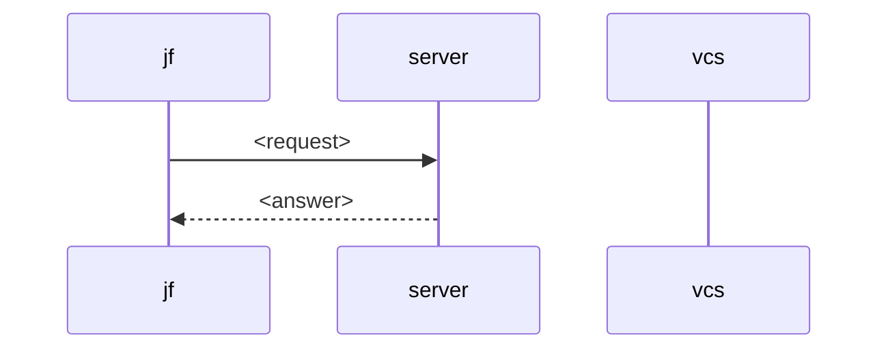

# Spec page template

Copy the block into `docs/specs/<epic>-<slug>.md` and replace each
placeholder. Drop an optional section the epic doesn't need. Drop the whole
design half, from Summary to Model and Alternatives, when the epic adds no
object, state, or protocol that another epic builds on.

````markdown
# <Epic name>

<What the epic delivers, with a link to the epic.> <The module that owns it
and the ADRs its paths follow.>

## Summary

<What the epic adds and what changes for a person, in at most six
sentences.>

## Motivation

<The problem today, who has it, and what leaving it costs.>

Goals, each one a demo can show:

- <Outcome.>

## Guide

<One worked example by the people of the seed, as if the epic were built.
Introduce each concept where the reader first meets it.>

```console
$ jf <command>
<output>
```

## Model

<Each object the epic adds, what identifies it, and whether it is stored or
derived.>

| Object   | Identified by | Holds    | Stored or derived |
| -------- | ------------- | -------- | ----------------- |
| <object> | <key>         | <fields> | <which, and why>  |

Invariants:

1. <A rule that holds after every operation, and what enforces it.>


## <What a person can do> (#<n>)

[#<n>](https://github.com/nca-apprentices/jjforge/issues/<n>) states the
requirement.

| ID      | Functional requirement                                              |
| ------- | ------------------------------------------------------------------- |
| <n>.1   | <Command or route> <does what>. <Refusal: status `problem code`.>    |

- Operations: <routes and `jf` commands>.
- Types: <proto messages, API schemas, and items of the Architecture and
  Libraries sections>.
- Flow: [<path>](#<path>).

Scenario: [<n>-<slug>.<hurl|bats>](../../e2e/<http|cli>/<n>-<slug>.<hurl|bats>).

## Out of scope

- <What a reader could expect, and the epic or decision that covers it.>

## Flow

### <Write path>

Operation `<operationId>` by principal P.



1. <Step>: <what happens>. Refused: <status> `<problem code>`.

## Persistence

<Object paths, tables with constraints and queries, and events with their
listeners.>

```mermaid
erDiagram
    <table> ||--o{ <table> : <relation>
```

## Architecture

| Crate or module | Item   | Kind                       | Role               |
| --------------- | ------ | -------------------------- | ------------------ |
| <crate>         | <item> | <struct, trait, or method> | <what it does>     |

External systems and their twins in `deploy/compose.yaml`: <system>
  as `<twin>`.

## Libraries

### <Library> <pinned version>

<Traits jjforge implements, types mapped field by field, calls made, and
parts left unused.>

## Compatibility

- <What an older `jf`, server, or vcs does while the others run the new
  version.>

## Operations

- <The signal that shows a path is healthy, its limit, and how it grows.>

## Security

- <What a path trusts, what it verifies, and the limit that bounds a hostile
  client.>

## Failures

<What each partial failure leaves behind, and who repairs it.>

## Tests

- <A test besides the scenarios, and what it proves.>

## Alternatives

### <Choice>

| Option   | Cost           |
| -------- | -------------- |
| <option> | <cost>         |
| <option> | <cost>. Chosen |

Drawbacks of the chosen design:

- <Drawback.>

## Prior art

| System   | What it does | What jjforge takes | What it leaves |
| -------- | ------------ | ------------------ | -------------- |
| <system> | <summary>    | <idea>             | <idea>         |

## Future possibilities

- <Extension the design leaves room for, and the epic that would build it.>

## Open questions

- <Question.> <The issue that answers it.>
````
