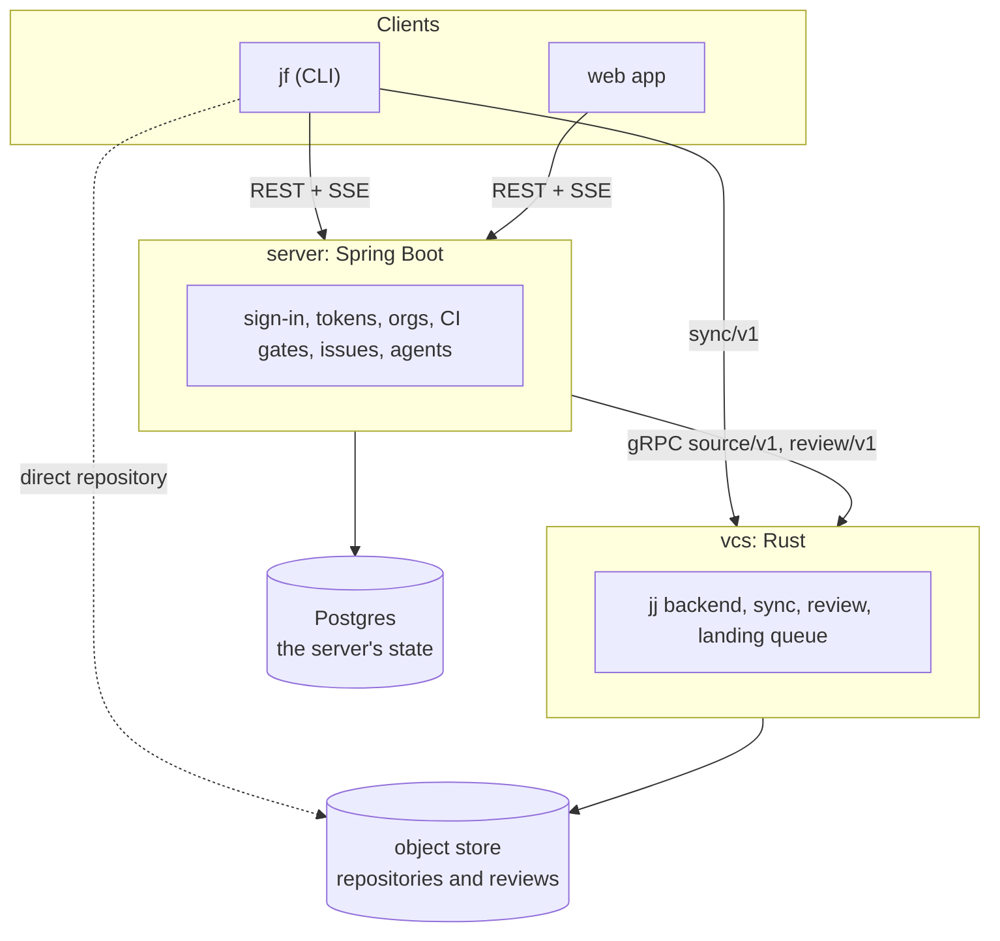

# Architecture

jjforge starts as a forge for Jujutsu repositories and grows into a platform
where people and agents build software with scoped, recorded access. The
decisions behind this page are in [adr/](adr/README.md).

## Components



vcs runs on its own as a forge with review and landing.
[ADR 0002](adr/0002-state-boundaries-and-tokens.md) decides that every
principal signs in to the server and proves who it is with a token. Until
sign-in exists ([#6](https://github.com/nca-apprentices/jjforge/issues/6)),
a request names its principal and vcs trusts the name. `jf` can also share
a repository through the object store alone, as
[ADR 0001](adr/0001-native-jj-without-git.md) decides.

## Review and landing

jj already holds most of what review needs. A change keeps its change ID
across rewrites, `jf evolog` lists its earlier versions, and a stack is a
chain of changes. jjforge adds review records keyed by change ID, and a
landing queue that moves trunk. The
[review model](specs/143-review-model.md) specifies them.

### A stack in review

`jf log` shows each change with its review state next to it. Here
`acme_owner` has a stack of two changes on trunk.

```console
$ jf log
@  vxqtpmsn acme_owner 7d21c0aa  round 1, waiting for review
│  Report rounds in jf review show
○  kmpsxqvo acme_owner e5b8f312  round 3, approved by acme_member
│  Count rounds from one
◆  zzlrnmto acme_member 41c6aa90 trunk
│  Add the review crate
~
```

A round is a version of a change that its owner marked ready, so the rounds
of a change are entries of its evolution log:

```console
$ jf evolog -r kmpsxqvo
○  kmpsxqvo e5b8f312  round 3, same patch, approval carried
│  rebase onto trunk
○  kmpsxqvo 7d21c0aa  round 2, new patch, approved again
│  edit
○  kmpsxqvo 3f9a1c2e  round 1, approved by acme_member
```

An approval holds for a round's patch. A rebase that changes no content
carries it, and an edit drops it.

### Two logs, one head

jj's operation log records each change to the repository. jjforge keeps a
review log beside it, and `HEAD` names the latest entry of both, so one
compare-and-swap moves them together. `jf op log` shows both:

```console
$ jf op log
@  4b1e7c0a vcs 10:42  land kmpsxqvo..vxqtpmsn on trunk
│  review: landed
○    9d3f2a11 vcs 10:31  merge concurrent operations
├─╮  review: the union of both
│ ○  c27e5d48 acme_member 10:30  approve vxqtpmsn, offline in a clone
○ │  81aa04b6 acme_lead 10:30  comment on kmpsxqvo, in the web app
├─╯
○  5e60b9f3 acme_owner 10:12  publish vxqtpmsn
│  review: round 1 of vxqtpmsn
```

Two writers that start from the same `HEAD` race on the swap. The loser
merges, as jj merges concurrent operations. Review records are facts that
never change, so the merge is their union and never conflicts.

### Landing

`jf land` on the top of a stack lands the whole stack, or none of it:

```console
$ jf land vxqtpmsn
Land request 01J9Z7 for kmpsxqvo..vxqtpmsn: queued
$ jf land --watch 01J9Z7
queued   → testing  tree 0c9e41b7, waiting for ci
testing  → landed   vxqtpmsn a4f07d55 on trunk
$ jf log
◆  vxqtpmsn acme_owner a4f07d55 trunk
│  Report rounds in jf review show
◆  kmpsxqvo acme_owner 19bd02ce
│  Count rounds from one
~
```

vcs checks that every change in the stack has an approval that holds,
rebases the stack onto trunk, and waits for a passing verdict on the top
tree from each gate that `.jjforge/landing.toml` on trunk requires. The
server answers the `ci` gate. Then one swap moves trunk and makes the old
commits the predecessors of the landed ones, so every clone replaces them.

## Building blocks

| #   | Block                          | What it holds                                                         |
| --- | ------------------------------ | --------------------------------------------------------------------- |
| 1   | Identity and authorization     | Principals, sign-in, tokens, policy, secrets, and the audit log       |
| 2   | Source plane                   | Repositories, changes, the operation log, conflicts, stacks, and sync |
| 3   | Spec and intent plane          | Specs linked to change IDs and traced to measurements                 |
| 4   | Execution plane                | Sandboxes, durable workflows, quotas, and the build cache             |
| 5   | Component registry             | Manifests, install as grant, and supply chain checks                  |
| 6   | Event bus and hooks            | Typed events, blocking gates, and observers                           |
| 7   | Measurement store              | Metrics, traces, and evaluations, keyed by change ID                  |
| 8   | Artifact and attestation store | Content-addressed outputs and the attestations attached to them       |
| 9   | Control plane                  | Organizations, configuration from the forge, tenancy, and metering    |
| 10  | Interfaces                     | The `jf` CLI, the web app, and the public API                         |

## Invariants

1. Every object is addressable by content hash or change ID.
2. Every action is attributable to a principal with a delegation chain.
3. Every capability is a scoped, expiring, identity-bound token.
4. Every state transition emits an event and is recorded.
5. Every component, including the platform's own, uses the same registry,
   permission, and sandbox path.

## Dependency order

Identity and token issuer → forge with an operation log event
stream → event bus and hook contract → sandbox runtime → component manifest
and registry → measurement store → spec plane → experimentation and promotion.

Specs and measurements depend on stable change IDs and events. The registry
depends on the permission model. Building the registry before the token
model would force a rewrite of every component. The milestones follow this order.

## Releases and deployment

This repository is the product. The shared cluster in
[nca-apprentices/infra](https://github.com/nca-apprentices/infra) is one
installation of it. The boundary follows these rules:

- The infra repository consumes only what a
  [release](development.md#releasing) publishes. It never references a path in
  this repository.
- A release doesn't deploy. Deploying is a change to `targetRevision` in the
  infra repository's `clusters/<env>/apps/jjforge/application.yaml`.
