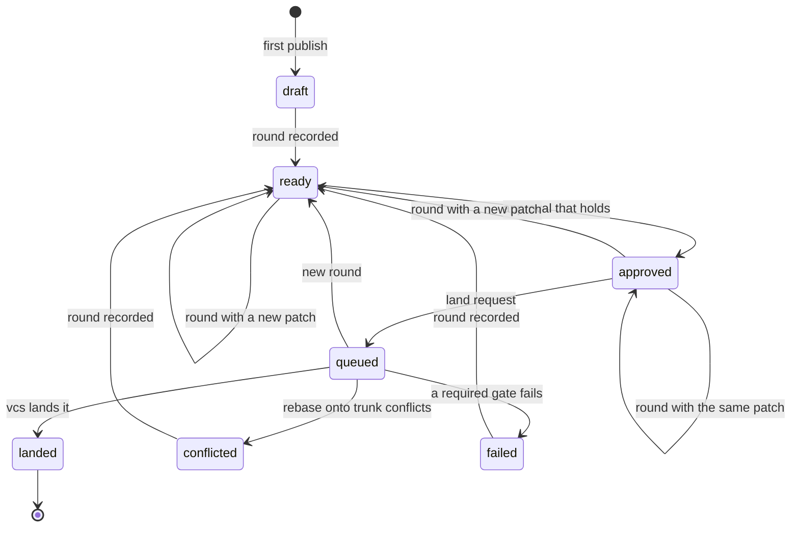
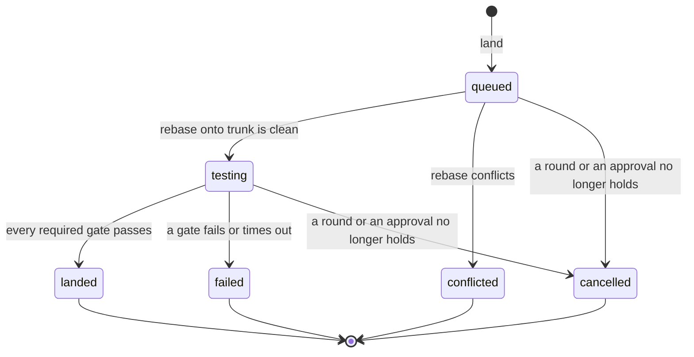
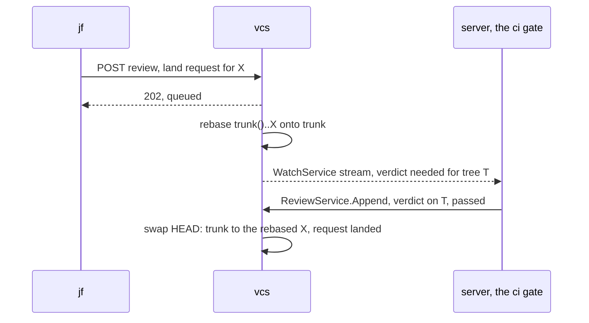

# Review model

The records that review and landing share: rounds, comments, approvals,
verdicts, land requests, and redactions, for
[#143](https://github.com/nca-apprentices/jjforge/issues/143). It comes before
[#58](https://github.com/nca-apprentices/jjforge/issues/58),
[#59](https://github.com/nca-apprentices/jjforge/issues/59),
[#60](https://github.com/nca-apprentices/jjforge/issues/60), and
[#65](https://github.com/nca-apprentices/jjforge/issues/65), whose pages
specify only their own requirements and link this page. vcs owns it and
keeps it in the repository, as
[ADR 0002](../adr/0002-state-boundaries-and-tokens.md) decides. The
repository stays native jj, as
[ADR 0001](../adr/0001-native-jj-without-git.md) decides.

## Summary

A change is the unit of review. There is no pull request. The owner marks a
commit of the change ready, which records a round. Reviewers comment on the
round's lines and approve its patch. An approval survives a new round whose
patch is the same, such as a rebase, and lapses on any change of content.
The records live in a review log next to the operation log, so a clone
carries them and vcs needs no database. A land request hands a stack to
vcs's queue, which rebases it onto trunk, waits for the verdicts of the
required gates, and moves trunk in one swap.

## Motivation

M2 moves jjforge's own review off GitHub. GitHub reviews a branch. A
rewritten commit gets a new SHA, so GitHub loses track of what was approved,
and a force push leaves no record of the earlier version. jj already keeps
what review needs: a change ID that survives rewrites, the earlier versions
of each change in the operation log, and conflicts stored in commits.

Four epics need the same records. Rounds and interdiffs
([#58](https://github.com/nca-apprentices/jjforge/issues/58)), the landing
queue ([#59](https://github.com/nca-apprentices/jjforge/issues/59)),
conflicts as work items
([#60](https://github.com/nca-apprentices/jjforge/issues/60)), and change
ownership ([#65](https://github.com/nca-apprentices/jjforge/issues/65)) each
read rounds and approvals.

Goals, each one a demo can show:

- A rebase that changes no content keeps its approval, and an edit drops it.
- The interdiff between two rounds shows only what the owner changed, never
  what trunk changed underneath.
- A comment stays on its line across rounds, or shows as outdated when its
  lines are gone.
- trunk only ever points at a tree that every required gate passed.
- A stack lands whole or not at all.
- vcs reviews and lands with no server running, and `jf` reviews offline
  from a clone.

## Guide

`acme_owner` and `acme_member` work on the repository `acme/forge`.

### Ask for review

`acme_owner` writes a change on trunk and marks it ready. `jf review ready`
publishes the commit and records round 1 in the same publish.

```console
$ jf new trunk() -m "Count rounds from one"
$ jf review ready
Round 1 of kmpsxqvo is ready: 3f9a1c2e on trunk 9b04d7e1
```

The change ID `kmpsxqvo` names the change in every later command. The
commit ID `3f9a1c2e` names this version of it.

### Review a round

`acme_member` fetches, reads the round, comments on a line, and approves.
Reading needs no network once fetched. The comment and the approval are
signed with `acme_member`'s SSH key and pushed.

```console
$ jf fetch
$ jf review show kmpsxqvo
kmpsxqvo  Count rounds from one  acme_owner  round 1 of 1
  src/round.rs  +14 -2
$ jf review comment kmpsxqvo --path src/round.rs --line 12 -m "Can k be 0 here?"
Comment 01J9Z3 on round 1, src/round.rs:12
$ jf review approve kmpsxqvo
Approved round 1 of kmpsxqvo
```

The approval names the round, so it holds for that round's patch: the
difference between the tree of the commit and the tree of its parents.

### Answer with a new round

`acme_owner` fixes the line and marks the change ready again. The content
changed, so the approval lapses.

```console
$ jf edit kmpsxqvo
$ jf review ready
Round 2 of kmpsxqvo is ready: 7d21c0aa on trunk 9b04d7e1
Approval by acme_member on round 1 lapsed: the patch changed
$ jf review show kmpsxqvo --interdiff 1..2
  src/round.rs  +1 -1
  01J9Z3 src/round.rs:12 carried to line 12
```

`acme_member` approves round 2. trunk moves, so `acme_owner` rebases and
marks round 3. The patch is the same, so the approval carries over.

```console
$ jf rebase -r kmpsxqvo -d trunk()
$ jf review ready
Round 3 of kmpsxqvo is ready: e5b8f312 on trunk 41c6aa90
Approval by acme_member on round 2 carried: the patch is the same
```

### Land

`acme_owner` asks to land. vcs rebases the stack onto trunk, waits for the
`ci` gate, which the server answers, and moves trunk.

```console
$ jf land kmpsxqvo
Land request 01J9Z7 for kmpsxqvo: queued
$ jf land --watch 01J9Z7
queued   → testing  tree 0c9e41b7, waiting for ci
testing  → landed   kmpsxqvo a4f07d55 on trunk
$ jf fetch
$ jf log -r kmpsxqvo
◆  kmpsxqvo acme_owner a4f07d55 trunk
│  Count rounds from one
```

The landed commit keeps the change ID and records `e5b8f312` as its
predecessor, so jj hides the replaced commit in every clone.

### Hit a conflict

Had trunk changed the same lines, vcs would report the conflict and take
the next request.

```console
$ jf land --watch 01J9Z7
queued   → conflicted  src/round.rs
$ jf rebase -r kmpsxqvo -d trunk()
$ jf resolve
$ jf review ready
Round 4 of kmpsxqvo is ready: 18aa3c09 on trunk 77e2b0c4
```

### Delete a comment

An administrator of `acme` deletes the text of a comment that leaked a secret.

```console
$ jf review redact 01J9Z3 -m "Leaked a token"
Text of 01J9Z3 deleted by acme_admin: Leaked a token
```

## Model

### Objects

| Object           | Identified by                    | Holds                                                                      | Stored or derived                                                   |
| ---------------- | -------------------------------- | -------------------------------------------------------------------------- | ------------------------------------------------------------------- |
| Change           | change ID                        | Its commits, in the operation log                                          | Stored by jj                                                        |
| Owner            | change ID                        | The principal of the first operation that published the change             | Derived from the operation log, as #65 decides                      |
| Review operation | BLAKE3 hash                      | Its parents, its records, the time, the principal, and the signature       | Stored in the review log                                            |
| Round            | change ID and round number       | The commit, its base tree, its tree, and whether its patch equals the last | Stored as a record                                                  |
| Patch            | a round                          | The base tree and the tree                                                 | Derived                                                             |
| Interdiff        | two rounds of one change         | The earlier patch rebased onto the later base, diffed with the later tree  | Derived on read                                                     |
| Comment          | 16 random bytes                  | The round, the side, the path, the lines, the text's hash, and a parent    | Stored as a record. Its place in a later round is derived           |
| Text             | BLAKE3 hash                      | The body of a comment                                                      | Stored on its own, so it can be deleted                             |
| Redaction        | the comment                      | The text's hash, the principal, and the reason                             | Stored as a record                                                  |
| Approval         | change ID, round, principal      | The principal and the time                                                 | Stored as a record. Whether it holds is derived                     |
| Verdict          | tree ID and gate                 | Pass or fail, a log address, and the principal                             | Stored as a record. The latest by the gate's principal counts       |
| Land request     | 16 random bytes                  | The top change, the bookmark, and its state                                | Stored as records, one per state                                    |
| Review view      | the review operation             | Each change's rounds, comments, approvals, and land requests               | Stored as a snapshot, as jj stores a view                           |

The base tree of a commit is the merge of its parents' trees, so a patch is
what `jf diff -r` shows for the round's commit.

### Records

- `HEAD` holds two IDs: the latest operation and the latest review
  operation. One compare-and-swap moves both, so a publish can make a
  commit visible and record its round at once, and a landing checks its
  approvals and moves trunk in the same write.
- A review operation names its parents. Two concurrent ones merge as the
  union of their records, ordered by time and then hash, as jj merges
  operations. Every record kind is a fact that never changes, so a union
  never conflicts.
- jj-lib's `op_store::View` has fixed fields, so the review view is a
  sibling of jj's view, never a field of it.
- Each record carries the SSHSIG of the principal who wrote it, under the
  namespace `jjforge-review`. vcs refuses a record whose signature doesn't
  match the request's certificate. The server signs for a person of the
  web app with its own key and names the person in the delegation chain.

### Invariants

1. A round's commit is the change's only visible commit after the publish
   that records it.
2. Round numbers of a change start at 1 and have no gaps. A merge of
   concurrent review operations that both record round k keeps the earlier
   one and drops the other, and its writer records again.
3. An approval on round j holds for round k ≥ j when every round from j + 1
   to k has the same patch as the round before it.
4. A verdict describes a tree, never a commit. Two commits with one tree
   share every verdict.
5. Only vcs's queue moves a protected bookmark. vcs refuses a publish that
   moves one, whatever the certificate.
6. The landed commits keep their change IDs and name the requested commits
   as predecessors.
7. trunk only points at a tree with a passing verdict from every required
   gate.
8. The landing policy, meaning the required gates, the principal trusted
   for each, and the time limit, comes from `.jjforge/landing.toml` in the
   tree of trunk's target, never from the tree being landed.

### A change in review

The state of a change is derived from its records and its visible commit.



### A land request



A request in a final state never moves again. The owner asks for a new one.

### Stacks

A land request on X lands the stack `trunk()..X` whole. Each change needs
an approval that holds on its latest round. The gates judge the tree of X,
because trunk moves straight to X and never points at the changes between.
Any failure fails the whole request.

### Direct repositories

A repository that `jf` reads and writes in the object store, as
[ADR 0001](../adr/0001-native-jj-without-git.md) allows, uses the same
records. `jf land` runs the same steps as vcs's queue, except that it has no
gates and no queue: it rebases the stack, checks its approvals, and swaps
`HEAD`. vcs writes `t/{org}/r/{repo}/SERVED` when it creates a repository,
and `jf` refuses to write directly to a repository that has it.

## Out of scope

- A policy language. M2 requires one approval by a member other than the
  owner, and the gates that `.jjforge/landing.toml` on trunk names. Policy
  as revsets and filesets waits for
  [#76](https://github.com/nca-apprentices/jjforge/issues/76).
- Running CI. The server answers the `ci` gate, and its sandboxes come with
  [#69](https://github.com/nca-apprentices/jjforge/issues/69).
- Inboxes, search, and notifications across repositories. The server
  derives them from vcs's stream.
- Who may report a comment, and how a moderator sees reports. The server
  adds them. A standalone vcs lets the organization's administrators redact.

## Flow

### Record a round

`jf review ready` by principal P, as one `POST {base}/publish`.

1. Session: vcs checks the session from P's certificate. Refused: 401
   `unauthenticated`. A principal outside the organization gets 404
   `not_found`.
2. Owner: P owns the change. Refused: 403 `not_owner`.
3. Commit: after the publish, C is the change's only visible commit.
   Refused: 409 `divergent` when the change has several.
4. Signature: the round's signature matches P's certificate. Refused: 400
   `bad_signature`.
5. Patch: vcs compares the patch of C with the previous round's, as
   `jj interdiff` does, and stores the answer on the round.
6. Swap: vcs writes the operation and the review operation, then swaps
   `HEAD`. Refused: 412 `precondition_failed` when the head moved. `jf`
   fetches, numbers the round again, and retries.

### Comment, approve, and redact

`jf review comment`, `approve`, and `redact` by principal P, as
`POST {base}/review` with signed records. The web app's calls reach the same
step through `ReviewService.Append` in `review/v1`.

1. Session and signature, as in [Record a round](#record-a-round).
2. Round: the round exists. Refused: 404 `not_found`.
3. Approval only: P isn't the owner. Refused: 403 `self_approval`. A second
   approval by P of the same round answers 200 and records nothing.
4. Redaction only: P administers the organization. Refused: 403
   `forbidden`. vcs swaps `HEAD` first, then deletes the text object, so a
   crash leaves the text present and redacted, and a retry deletes it.
5. Text: a comment's text is uploaded to `t/{org}/r/{repo}/text/{hash}`
   before the record that names it.
6. Swap, as in [Record a round](#record-a-round).

### Land

`jf land` by principal P, then vcs's queue.



The request:

1. Session, signature, and owner, as in [Record a round](#record-a-round).
2. Approval: every change in `trunk()..X` has an approval that holds on its
   latest round. Refused: 409 `not_approved`.
3. Swap: the request is recorded as `queued`. The answer is 202.

The queue, per repository and bookmark, re-reads every fact at each step
and commits each step with one swap of `HEAD`, so two replicas that run the
same step race safely and one of them reloads:

1. Holds: every round and approval of step 2 still holds. Otherwise the
   request moves to `cancelled` with the reason.
2. Policy: vcs reads `.jjforge/landing.toml` from trunk's target.
3. Rebase: vcs rebases the stack onto trunk's target and writes the commits
   and trees, without publishing them. A conflict moves the request to
   `conflicted` with the paths, and the queue takes the next request.
4. Gates: for each required gate, the latest verdict on the top tree by the
   gate's principal. A missing one streams `VerdictNeeded` and moves the
   request to `testing`. A failed one, or none within the time limit, moves
   it to `failed`.
5. Land: one swap of `HEAD` moves trunk to the rebased top, hides the
   requested commits, names them as predecessors, and records `landed`.

## Persistence

The object store holds everything, under the repository's prefix, as
[ADR 0002](../adr/0002-state-boundaries-and-tokens.md) lays it out. Review
operations and review views are objects in the segments, next to
operations and views. Text sits outside the segments, one object each, so a
redaction can delete it. Postgres holds nothing of review.

`store.v1` gains `ReviewOperation`, `ReviewView`, and one message per
record kind, and `Operation` gains a `signature` that jj-lib never sees, as
it never sees `segment_ids`.

## Architecture

| Binary | Crate or module | Item                 | Kind    | Role                                                                                        |
| ------ | --------------- | -------------------- | ------- | ------------------------------------------------------------------------------------------- |
| both   | `review`        | `Review`             | crate   | Records, the review view, interdiffs, the rules of each step, and landing, for vcs and `jf` |
| vcs    | `sync`          | `POST {base}/review` | route   | Appends signed records.                                                                     |
| vcs    | `queue`         | `Queue`              | worker  | Runs each repository's land requests.                                                       |
| vcs    | `grpc`          | `review/v1`          | service | `Append` for the server, and `Watch`, which streams records and verdicts needed.            |
| `jf`   | `commands`      | `review`, `land`     | module  | The commands of the [Guide](#guide), over `sync/v1` or on a direct repository.              |
| server | `gates`         | `CiGate`             | worker  | Answers the `ci` gate.                                                                      |

## Compatibility

- `HEAD` holds an encoded `store.v1.Head` with two IDs. vcs reads a `HEAD`
  of 32 bytes, as it wrote one before, as an operation ID alone, and writes
  the new form on the next publish.
- `store.v1`, `sync/v1`, and `review/v1` change by addition only.
- An older `jf` pushes and fetches, ignores the review log, and has no
  `review` or `land`.

## Security

- vcs decides ownership from the operation log, never from the request.
- No certificate moves a protected bookmark. Only the queue does.
- vcs counts a verdict only from the principal that the policy on trunk
  names for its gate, so a change can't relax its own gates.
- A comment body is text. The web app renders it as Markdown without HTML.
- In a direct repository no rule holds, and readers trust signatures only.

## Failures

- A crash before the swap leaves objects that nothing names, which cost
  storage only.
- A crash after the rebase and before the swap repeats the rebase, which
  writes the same objects again.
- A gate that never answers fails the request after the policy's time
  limit.

## Alternatives

### Where the records live

| Option                                                    | Cost                                                                   |
| --------------------------------------------------------- | ---------------------------------------------------------------------- |
| Postgres in the server                                    | vcs can't land on its own, and a clone can't review offline            |
| Fields in jj's view                                       | jj-lib drops fields it doesn't know on every operation                 |
| Bookmarks to metadata commits, as Gerrit NoteDb uses refs | The metadata commits show in `jf log` and in every revset over `all()` |
| A review log next to the operation log, under one `HEAD`  | Pushes and comments contend on one compare-and-swap. Chosen            |

### What an approval binds to

| Option                         | Cost                                                               |
| ------------------------------ | ------------------------------------------------------------------ |
| The commit                     | Every rebase drops it, as GitHub's dismissal of stale reviews does |
| The tree                       | Every move of trunk under the change changes the tree and drops it |
| The patch, carried while equal | One interdiff per round. Chosen                                    |

### Who runs the queue

| Option                                               | Cost                                                                   |
| ---------------------------------------------------- | ---------------------------------------------------------------------- |
| The server, which calls vcs to rebase and move trunk | vcs alone can't land                                                   |
| vcs, with the server as a gate                       | vcs waits on a principal it doesn't control, so gates time out. Chosen |

### What a land request lands

| Option                          | Cost                                                         |
| ------------------------------- | ------------------------------------------------------------ |
| Each change of a stack alone    | trunk can point at a change whose parent failed              |
| The whole stack in one swap     | A stack waits for its slowest change. Chosen                 |

### How a comment is deleted

| Option                                        | Cost                                                                 |
| --------------------------------------------- | -------------------------------------------------------------------- |
| A marker only, the text kept                  | A leaked secret stays in the store                                   |
| Rewrite the review log without the comment    | Every clone diverges, and signatures over later operations break     |
| Text as its own object, deleted with a marker | One more request to read a comment. Chosen                           |

### What a conflict at landing does

| Option                                        | Cost                                                                                      |
| --------------------------------------------- | ----------------------------------------------------------------------------------------- |
| Stop the queue until it is resolved           | One conflict blocks every other change                                                    |
| Publish the conflicted rebase as a new commit | The forge rewrites the owner's change, and the owner's clone diverges from what they edit |
| Record it on the request and move on          | The owner rebases and resolves locally. Chosen                                            |

Drawbacks of the chosen design:

- A clean rebase can still combine two patches that are wrong together.
  Only the gates on the top tree catch it.
- The serial queue lands at most one stack per gate run.
- A redacted text stays in every clone that fetched it.

## Prior art

| System                          | What it does                                                                                         | What jjforge takes                                                               | What it leaves                                          |
| ------------------------------- | ---------------------------------------------------------------------------------------------------- | -------------------------------------------------------------------------------- | ------------------------------------------------------- |
| Gerrit                          | Reviews a change across patch sets by its `Change-Id`, and copies votes by a label's `copyCondition` | The change as the unit, rounds as patch sets, votes copied on an unchanged patch | Labels with scores, and the footer that jj doesn't need |
| Gerrit NoteDb                   | Keeps review data in the repository, in refs                                                         | Review data in the repository                                                    | Refs to metadata commits                                |
| `jj interdiff`                  | Rebases one revision onto the parents of another and diffs the result                                | The interdiff, computed the same way                                             | Nothing                                                 |
| Phabricator Differential        | Shows the diff between two updates of a revision                                                     | Comments carried to later updates or marked outdated                             | Revisions as objects apart from commits                 |
| Sapling and Mononoke pushrebase | Rebases a pushed commit onto the server's head when the files don't overlap                          | Rebase at landing, on the server                                                 | Refusing any file overlap, since jj merges hunks        |
| bors                            | Tests the merged result before main moves, one at a time                                             | trunk only moves to a tested tree                                                | Merge commits                                           |
| Zuul                            | Tests a queue of changes speculatively, and gates Gerrit from outside                                | The gate as a separate system                                                    | Speculation, until throughput asks for it               |

## Future possibilities

- Verifying every operation and record on read, so a direct repository
  detects writes that its rules forbid.
- Speculative batches with bisection, once the queue's wait time says so.
- Policy as revsets and filesets, with
  [#76](https://github.com/nca-apprentices/jjforge/issues/76).
- A head per log, if a measurement shows that comments slow pushes.

## Open questions

- The requirements of
  [#143](https://github.com/nca-apprentices/jjforge/issues/143) aren't
  filed. Their sections, scenarios, and the `store.v1` and `sync/v1`
  messages follow once they are.
- How vcs finds repositories with pending requests after a restart without
  listing every repository. An index object per organization is the likely
  answer.
- Whether jj-lib 0.46 rebases local descendants when
  `RepoLoader::merge_operations` merges an operation that rewrote their
  parent. Reading jj-lib at the pinned version answers it.
- The domain of the certificate extensions that carry scopes and the
  delegation chain, and the Rust and Java libraries that parse and sign
  certificates. The first requirement's Libraries section answers it.
