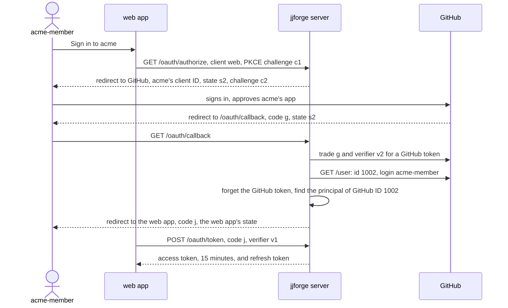
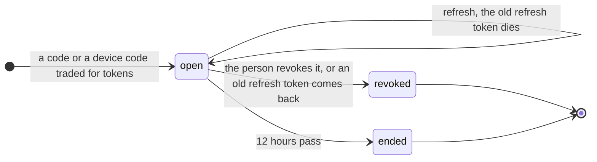
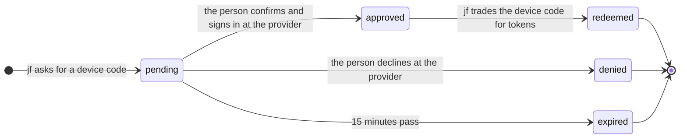
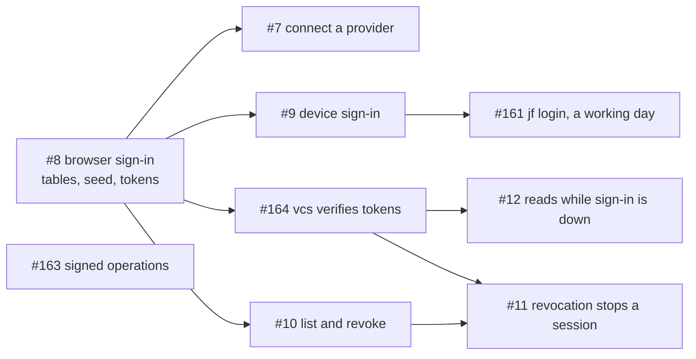
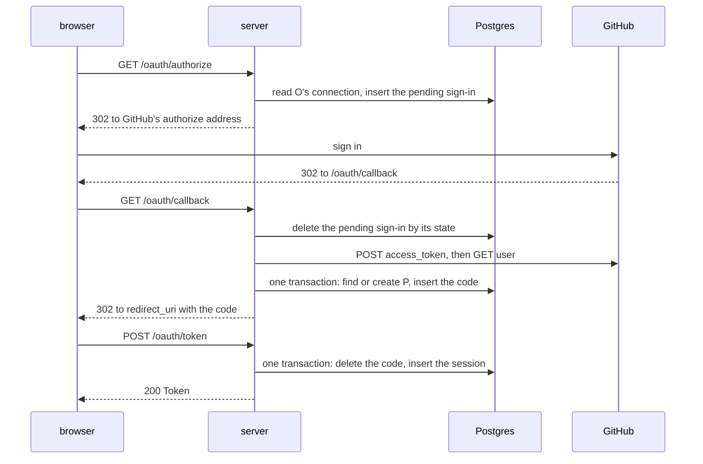
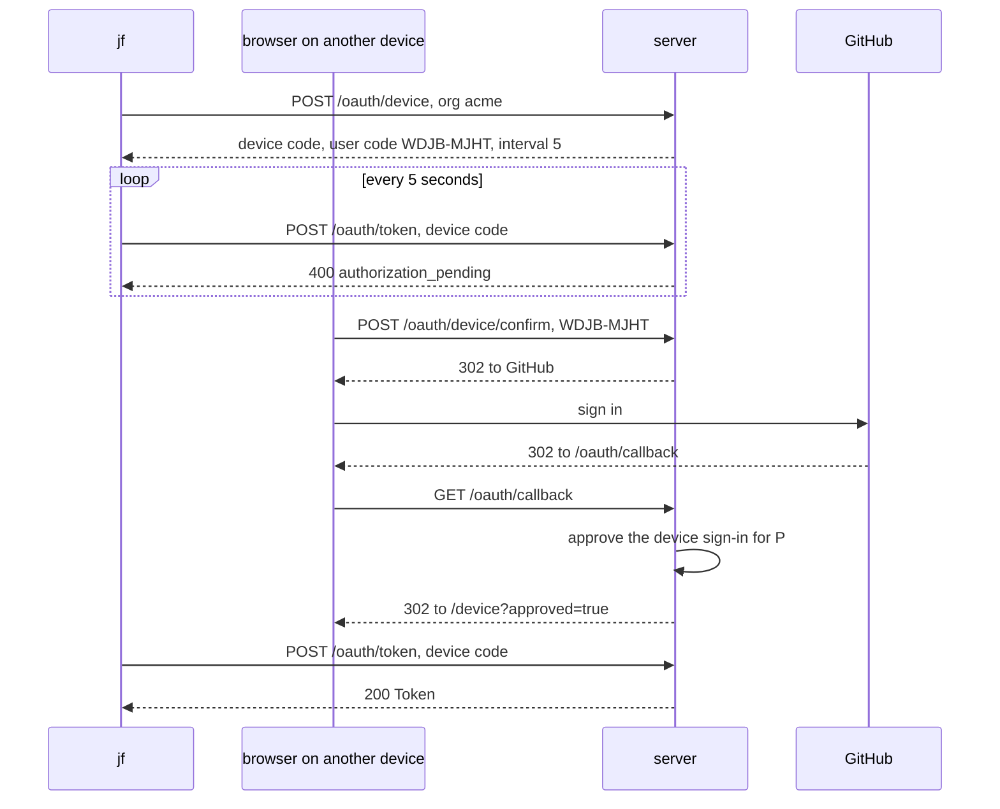
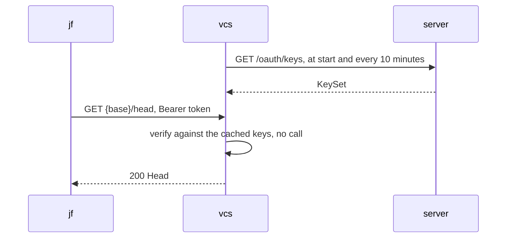
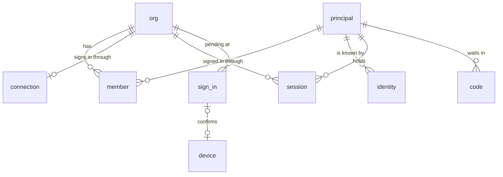

# Human login

People sign in to jjforge through their organization's identity provider,
from a browser and from a terminal, for
[#6](https://github.com/nca-apprentices/jjforge/issues/6). The server's
`identity` module owns sign-in, sessions, and tokens in the Postgres schema
`identity`. vcs verifies tokens on its own and signs what it writes. The
paths follow [ADR 0002](../adr/0002-state-boundaries-and-tokens.md),
[ADR 0007](../adr/0007-one-identity-for-access-and-signatures.md), and
[ADR 0008](../adr/0008-sign-in-through-a-provider-sessions-from-the-forge.md).

The page teaches how sign-in works as it specifies it. A reader new to
OAuth reads the [Guide](#guide) first and the [Flow](#flow) second. GitHub is
the first provider. The scenarios run against the twin of GitHub in
`deploy/compose.yaml`, and a real GitHub app waits for the first deployment.

## Summary

An owner connects their organization to GitHub. A person then signs in with
their GitHub account, in the web app or with `jf login`, and jjforge gives
them a session of its own. GitHub proves who the person is, and jjforge
decides what they may do and issues the tokens. A short access token goes
with every request, and a refresh token renews it for a working day. The
server checks each session on every request, and vcs checks only the token's
signature, so repositories stay readable while sign-in is down.

## Motivation

Today vcs trusts the name in `Authorization: Bearer acme-owner`. Anyone who
reaches vcs can claim any name, so the forge can't run anywhere but on a
developer's machine. Every later epic needs a principal that the forge has
verified: authorization in
[#13](https://github.com/nca-apprentices/jjforge/issues/13), agents in
[#18](https://github.com/nca-apprentices/jjforge/issues/18), and signed
reviews in [#143](https://github.com/nca-apprentices/jjforge/issues/143).
Without sign-in, M1 can't be deployed.

Goals, each one a demo can show:

- A person signs in from a browser with GitHub, and the web app shows who
  they are.
- A person signs in from a terminal without a browser by typing a code on
  their phone.
- A person pushes in the morning and in the evening without signing in
  again.
- A person ends one of their sessions, and it stops working.
- A clone works while the server is down.
- A request that only names a person reaches no repository.

## Guide

### The words of sign-in

Sign-in answers two questions: who is this, and may they do this. jjforge
asks GitHub the first one, and answers the second one itself.

```yaml table
- Word: Identity provider
  Meaning: >
    The system that already knows the person and checks their password,
    such as GitHub. Here, "provider" for short.
  In this epic: >
    Each organization connects one. GitHub is the first, and its twin runs
    in compose.
- Word: Identity
  Meaning: >
    Who the person is at the provider: the provider and its stable ID for
    them.
  In this epic: >
    GitHub's numeric user ID, such as 1001. Never the login, because a
    login can change and pass to someone else.
- Word: Principal
  Meaning: Who the person is in jjforge.
  In this epic: >
    Created on the first sign-in, with a UUID and a name, such as
    acme-owner.
- Word: Session
  Meaning: One sign-in on one device. It ends after 12 hours or when revoked.
  In this epic: A row in Postgres that the server checks on every request.
- Word: Access token
  Meaning: >
    A short-lived proof, sent with every request, that the session's
    principal sent it.
  In this epic: >
    A JWT that the server signs with Ed25519. It lives 15 minutes.
- Word: Refresh token
  Meaning: >
    A long-lived secret that a client trades for a new access token, and
    only at the token endpoint.
  In this epic: Replaced on every use, and lives as long as its session.
- Word: Client
  Meaning: The program that asks for tokens on the person's behalf.
  In this epic: The web app, as `web`, and the CLI, as `jf`.
- Word: Authorization code
  Meaning: >
    A one-time code that a browser carries back to the client after
    sign-in. The client trades it for tokens.
  In this epic: Lives 60 seconds, and works once.
- Word: PKCE
  Meaning: >
    The client sends a hash of a secret when it starts, and the secret
    itself when it trades the code. A stolen code is worthless without
    it.
  In this epic: >
    Required, with S256, between the client and jjforge and between jjforge
    and GitHub.
- Word: State
  Meaning: >
    A random value that a redirect carries out and back, so the receiver
    knows the answer belongs to a request it made.
  In this epic: Checked at every redirect.
- Word: Device flow
  Meaning: >
    A sign-in for a machine without a browser. The machine shows a code,
    and the person types it on a device that has one.
  In this epic: How `jf login` signs in, on every machine.
```

### Connect the provider

`acme-owner` registers an OAuth app for acme on GitHub with the callback
address `https://jjforge.example/oauth/callback`, and gives jjforge its
client ID and secret. The answer never repeats the secret.

```console
$ curl -X PUT https://jjforge.example/api/v1/orgs/acme/identity-provider \
    -H "Authorization: Bearer $TOKEN" -H 'content-type: application/json' \
    -d '{"issuer": "https://github.com", "clientId": "acme-jjforge", "clientSecret": "…"}'
{"issuer": "https://github.com", "clientId": "acme-jjforge"}
```

### Sign in from the browser

`acme-member` opens the web app, types `acme`, and presses Sign in. The
browser travels to GitHub and back, and nobody types a jjforge password,
because jjforge has none.



There are two sign-ins in a row, and the same steps protect both. jjforge
is a client of GitHub, and the web app is a client of jjforge. Each client
checks the state that comes back, and proves with PKCE that it started the
request that a code answers.

```console
$ curl -H "Authorization: Bearer $ACCESS" https://jjforge.example/api/v1/me
{"id": "0199c9a1-7c00-7000-8000-00000000ac02", "kind": "human", "name": "acme-member"}
```

### Sign in from a terminal

`acme-owner` works on a server over SSH, which has no browser.

```console
$ jf login --org acme
Open https://jjforge.example/device and enter WDJB-MJHT
Waiting for you to confirm…
```

On a phone, `acme-owner` opens the page, types `WDJB-MJHT`, and signs in at
GitHub as in the browser. Meanwhile `jf` asks the token endpoint every 5
seconds, and hears `authorization_pending` until the phone is done:

```console
Signed in as acme-owner
```

`jf` saves the tokens in `~/.config/jjforge/credentials.toml`, which only
its owner can read.

### Work all day

`acme-owner` pushes in the morning, and again after lunch. The access token
from the morning expired long ago. Before the push, `jf` traded the refresh
token for a new access token and a new refresh token, without a word.

```console
$ jf push --bookmark main
Pushed main to 4b1e7c0a
```

At the end of the day, 12 hours after `jf login`, the session ends, and no
refresh renews it:

```console
$ jf push --bookmark main
Your session ended. Run jf login --org acme.
$ echo $?
5
```

### End a session

`acme-member` left a session open on a shared machine. From their laptop,
they list their sessions and end that one.

```console
$ curl -H "Authorization: Bearer $ACCESS" https://jjforge.example/api/v1/me/sessions
{"items": [
  {"id": "0199d1c2-…", "client": "web", "org": "acme", "current": true, …},
  {"id": "0199d0aa-…", "client": "jf", "org": "acme", "current": false, …}
]}
$ curl -X DELETE -H "Authorization: Bearer $ACCESS" \
    https://jjforge.example/api/v1/me/sessions/0199d0aa-…
```

The server refuses that session's tokens at once. vcs doesn't ask the
server, so it accepts the session's last access token until it expires,
within 15 minutes.

### What proves what

```yaml table
- Who checks: The person's browser, at GitHub
  What: The person's GitHub password, and two factors if they set them up
  With: GitHub's own sign-in
- Who checks: The server, at the callback
  What: That GitHub's answer belongs to a sign-in it started
  With: The state, and its own PKCE verifier
- Who checks: The server, at the token endpoint
  What: That the client trading a code is the one that asked for it
  With: The client's PKCE verifier and the registered redirect address
- Who checks: The server, on every request
  What: That the token is genuine, current, and its session still open
  With: The signature, the expiry, and the session row
- Who checks: vcs, on every request
  What: That the token is genuine and current
  With: The signature and the expiry, against keys it fetched earlier
- Who checks: Anyone with a clone
  What: That vcs wrote each operation and nothing changed it since
  With: The operation's signature and the key at `/sync/v1/keys`
```

## Model

```yaml table
- Object: "Organization"
  Identified by: "UUIDv7, and a unique name"
  Holds: "Its name"
  Stored or derived: "Stored. #24 creates them through the API"
- Object: "Member"
  Identified by: "organization and principal"
  Holds: "The role, `owner` or `member`"
  Stored or derived: "Stored. #14 changes them through the API"
- Object: "Connection"
  Identified by: "organization"
  Holds: "The issuer, the client ID, and the encrypted client secret"
  Stored or derived: "Stored"
- Object: "Principal"
  Identified by: "UUIDv7, and a unique name"
  Holds: "Its kind and name"
  Stored or derived: "Stored"
- Object: "Identity"
  Identified by: "provider and subject"
  Holds: "The principal, and the login at the last sign-in"
  Stored or derived: "Stored"
- Object: "Pending sign-in"
  Identified by: "the hash of its state"
  Holds: "Its purpose, the client's request, and jjforge's PKCE verifier"
  Stored or derived: "Stored for 10 minutes"
- Object: "Code"
  Identified by: "the hash of the code"
  Holds: "The principal, the client, its redirect address, and challenge"
  Stored or derived: "Stored for 60 seconds"
- Object: "Device sign-in"
  Identified by: "UUIDv7, its code's hash, and its user code"
  Holds: "The client, the scope, its status, and the principal"
  Stored or derived: "Stored for 15 minutes"
- Object: "Session"
  Identified by: "UUIDv7"
  Holds: "The principal, the client, the hash of the refresh token, times"
  Stored or derived: "Stored"
- Object: "Access token"
  Identified by: "its session and its expiry"
  Holds: "The claims of ADR 0008"
  Stored or derived: "Derived, signed, never stored"
- Object: "Signing key"
  Identified by: "an ID such as `2026-11`"
  Holds: "An Ed25519 key pair"
  Stored or derived: "Configuration, one directory per binary"
```

Invariants:

1. jjforge stores no password and no provider token. The server reads the
   person's ID from GitHub and drops GitHub's token before it answers.
2. An identity belongs to one principal, and a principal's name never
   changes. The primary key of `identity` holds the first, and the unique
   name the second.
3. Every code, state, device code, and refresh token is 32 random bytes,
   and Postgres holds only its SHA-256 hash, so a copy of the database
   signs nobody in.
4. A code and a device code give tokens once. The row is deleted or marked
   in the transaction that issues the tokens.
5. An access token never outlives its session: `exp` is at most the
   session's `expires_at`.
6. A session has one live refresh token. A refresh replaces its hash in
   the same transaction that answers it.
7. vcs accepts a token only when a key that the server published verifies
   its signature, and its `iss`, `aud`, `nbf`, and `exp` hold.



A device sign-in moves through its own states:



## Connect an organization's identity provider (#7)

[#7](https://github.com/nca-apprentices/jjforge/issues/7) states the
requirement.

```yaml table
- ID: "7.1"
  Functional requirement: >
    `setIdentityProvider` by an owner, with the issuer `https://github.com`,
    a client ID, and a client secret, answers 200 with the issuer and the
    client ID, never the secret.
- ID: "7.2"
  Functional requirement: >
    A sign-in through the organization that starts after the answer
    redirects to GitHub with the new client ID.
- ID: "7.3"
  Functional requirement: >
    A member who isn't an owner gets 403 `forbidden`. The server reads the
    role from `identity.member` until
    [#15](https://github.com/nca-apprentices/jjforge/issues/15) moves the
    decision into the policy.
- ID: "7.4"
  Functional requirement: >
    A principal outside the organization gets 404 `not_found`, never 403.
- ID: "7.5"
  Functional requirement: >
    Any issuer other than `https://github.com` gets 400 `invalid`, with a
    detail that names the one issuer the server supports.
- ID: "7.6"
  Functional requirement: A request without `clientSecret` gets 400 `invalid`.
- ID: "7.7"
  Functional requirement: A request without a token gets 401 `unauthenticated`.
- ID: "7.8"
  Functional requirement: >
    The server encrypts the secret with AES-256-GCM under
    `JJFORGE_SECRETS_KEY` before it stores it, with a fresh nonce each time.
```

- Operations: `setIdentityProvider` and `authorize`.
- Types: `IdentityProvider`, `Problem`, the `identity.connection` and
  `identity.member` tables, and the `identity` module's `Connections` and
  `SecretBox`.
- Flow: [connect a provider](#connect-a-provider).

Scenario: [7-connect-provider.hurl](../../e2e/http/7-connect-provider.hurl).

## Sign in through the organization's identity provider (#8)

[#8](https://github.com/nca-apprentices/jjforge/issues/8) states the
requirement.

```yaml table
- ID: "8.1"
  Functional requirement: >
    `authorize` with the client `web`, its registered `redirect_uri`, an
    `org`, a `state`, and an S256 challenge redirects with 302 to the
    organization's provider. The address carries the connection's client ID,
    a new state, and a new challenge of the server's own.
- ID: "8.2"
  Functional requirement: >
    The provider's login sends the browser to `authorizeCallback` at
    `{JJFORGE_PUBLIC_URL}/oauth/callback`.
- ID: "8.3"
  Functional requirement: >
    `authorizeCallback` with a known state trades the code at the provider,
    reads the GitHub user, finds or creates its principal, and redirects
    with 302 to the client's `redirect_uri` with a new code and the client's
    `state`.
- ID: "8.4"
  Functional requirement: >
    `token` with the grant `authorization_code`, the code, the same
    `redirect_uri`, and the verifier answers 200 with a `Token`: a JWT
    access token, `expires_in` of at most 900, a refresh token that starts
    with `jfr_`, and the scope `read write` when the request named none.
- ID: "8.5"
  Functional requirement: A code used a second time gets 400 `invalid_grant`.
- ID: "8.6"
  Functional requirement: >
    `getMe` with the access token answers 200 with the principal's ID, the
    kind `human`, and its name.
- ID: "8.7"
  Functional requirement: >
    A verifier whose SHA-256 isn't the challenge, a code older than 60
    seconds, or another `redirect_uri` gets 400 `invalid_grant`.
- ID: "8.8"
  Functional requirement: >
    An unknown `client_id`, or a `redirect_uri` that the client didn't
    register, gets 400 `invalid` and no redirect.
- ID: "8.9"
  Functional requirement: >
    With a valid client and redirect, a missing `org`, an organization
    without a connection, or a missing challenge redirects to the client
    with `error=invalid_request` and the client's state.
- ID: "8.10"
  Functional requirement: >
    `authorizeCallback` with `error` from the provider redirects to the client
    with `error=access_denied`. A provider that fails to answer gives
    `error=server_error`, and the server logs why.
- ID: "8.11"
  Functional requirement: >
    `authorizeCallback` with a state that the server never issued, or issued
    more than 10 minutes ago, gets 400 `invalid`.
- ID: "8.12"
  Functional requirement: >
    The server finds the principal by GitHub's numeric `id`. A person whose
    login changed signs in as the same principal, and the server records the
    new login on the identity.
- ID: "8.13"
  Functional requirement: >
    A new principal takes the GitHub login as its name. When another
    principal holds that name, it takes `{login}-2`, then `-3`, and on.
- ID: "8.14"
  Functional requirement: >
    An operation that needs a token gets 401 `unauthenticated` without one.
- ID: "8.15"
  Functional requirement: >
    No table holds a password or a provider token. The server drops
    GitHub's token once it has read the user.
```

- Operations: `authorize`, `authorizeCallback`, `token`, `getMe`, `getKeys`,
  and `getAuthorizationServerMetadata`.
- Types: `Token`, `OAuthError`, `Principal`, `Problem`, the `identity`
  tables, the module's `SignIns`, `GitHubProvider`, `Principals`,
  `Sessions`, `TokenSigner`, and `BearerFilter`, and Nimbus's `JWSObject`.
- Flow: [browser sign-in](#browser-sign-in) and
  [a request to the server](#a-request-to-the-server).

Scenario: [8-browser-sign-in.hurl](../../e2e/http/8-browser-sign-in.hurl).

## Sign in on a machine without a browser (#9)

[#9](https://github.com/nca-apprentices/jjforge/issues/9) states the
requirement.

```yaml table
- ID: "9.1"
  Functional requirement: >
    `authorizeDevice` with the client `jf` and an `org` answers 200 with a
    device code, a user code of two groups of four letters from
    `BCDFGHJKLMNPQRSTVWXZ`, `verification_uri` set to
    `{JJFORGE_PUBLIC_URL}/device`, the code in
    `verification_uri_complete`, `expires_in` of 900, and `interval` of 5.
- ID: "9.2"
  Functional requirement: >
    `token` with the device code grant answers 400 `authorization_pending`
    until the person confirms.
- ID: "9.3"
  Functional requirement: >
    A poll sooner than the interval after the last one answers 400
    `slow_down` and adds 5 seconds to the device sign-in's interval.
- ID: "9.4"
  Functional requirement: >
    `authorizeDeviceConfirm` with a pending user code redirects with 302 to the
    organization's provider, as 8.1 does. It takes the code in upper or
    lower case, with or without the dash.
- ID: "9.5"
  Functional requirement: The provider's login sends the browser to `authorizeCallback`.
- ID: "9.6"
  Functional requirement: >
    `authorizeCallback` for a device sign-in approves it for the principal and
    redirects to `{JJFORGE_PUBLIC_URL}/device?approved=true`.
- ID: "9.7"
  Functional requirement: >
    The next poll after the interval answers 200 with a `Token` for that
    principal, and its session's client is `jf`.
- ID: "9.8"
  Functional requirement: A redeemed device code gets 400 `invalid_grant`.
- ID: "9.9"
  Functional requirement: >
    `authorizeDeviceConfirm` with a code that isn't pending redirects to
    `{JJFORGE_PUBLIC_URL}/device?error=unknown_code`.
- ID: "9.10"
  Functional requirement: >
    `authorizeDevice` without `org`, or for an organization without a
    connection, gets 400 `invalid_request`.
- ID: "9.11"
  Functional requirement: >
    `authorizeDevice` by any client but `jf` gets 400 `invalid_client`.
- ID: "9.12"
  Functional requirement: >
    When the provider answers `error`, the callback redirects to
    `/device?error=access_denied`, and the next poll answers 400
    `access_denied`.
- ID: "9.13"
  Functional requirement: >
    A poll after 15 minutes answers 400 `expired_token`.
```

A scenario can't wait 15 minutes, so a test of the
[Tests](#tests) section checks 9.13.

- Operations: `authorizeDevice`, `authorizeDeviceConfirm`, `authorizeCallback`, and
  `token`.
- Types: `DeviceAuthorizationRequest`, `DeviceAuthorization`,
  `DeviceConfirmation`, `Token`, `OAuthError`, the `identity.device` table,
  and the module's `Devices`.
- Flow: [device sign-in](#device-sign-in).

Scenario: [9-device-sign-in.hurl](../../e2e/http/9-device-sign-in.hurl).

## List and revoke sessions (#10)

[#10](https://github.com/nca-apprentices/jjforge/issues/10) states the
requirement.

```yaml table
- ID: "10.1"
  Functional requirement: >
    `listSessions` answers the principal's open sessions, newest first, one
    page at a time. Each has its ID, client, organization, `createdAt`,
    `lastUsedAt`, and `expiresAt`, and the session of the request's token
    has `current` set.
- ID: "10.2"
  Functional requirement: >
    `revokeSession` on one of the principal's own open sessions answers 204
    and sets its `revoked_at`.
- ID: "10.3"
  Functional requirement: A revoked or ended session leaves the list.
- ID: "10.4"
  Functional requirement: >
    `revokeSession` on a session that is already revoked or ended gets 404
    `not_found`.
- ID: "10.5"
  Functional requirement: >
    `revokeSession` on another principal's session gets 404 `not_found` and
    changes nothing.
- ID: "10.6"
  Functional requirement: Both operations get 401 `unauthenticated` without a token.
- ID: "10.7"
  Functional requirement: >
    `lastUsedAt` moves on a refresh and on a request to the server, at most
    once a minute.
```

- Operations: `listSessions` and `revokeSession`.
- Types: `SessionPage`, `Session`, `Problem`, the `identity.session`
  table, and the module's `Sessions`.
- Flow: [revoke](#revoke).

Scenario: [10-sessions.hurl](../../e2e/http/10-sessions.hurl).

## A revoked session stops working (#11)

[#11](https://github.com/nca-apprentices/jjforge/issues/11) states the
requirement.

```yaml table
- ID: "11.1"
  Functional requirement: >
    `token` with the grant `refresh_token` answers 200 with a new access
    token and a new refresh token, and the old refresh token stops working.
- ID: "11.2"
  Functional requirement: >
    `revoke` with a refresh token answers 200 and revokes its session.
- ID: "11.3"
  Functional requirement: >
    The server answers 401 `unauthenticated` to an access token of a revoked
    or ended session at once.
- ID: "11.4"
  Functional requirement: >
    A refresh token of a revoked or ended session gets 400 `invalid_grant`.
- ID: "11.5"
  Functional requirement: >
    vcs accepts an access token of a revoked session until its `exp`, as
    ADR 0008 decides.
- ID: "11.6"
  Functional requirement: >
    `revoke` with a token that jjforge doesn't know answers 200, as RFC 7009
    decides.
- ID: "11.7"
  Functional requirement: >
    A refresh token that was already used gets 400 `invalid_grant` and
    revokes its session, so the newest refresh token and access token stop
    working too.
- ID: "11.8"
  Functional requirement: >
    vcs answers 401 `unauthenticated` to an access token more than 5 seconds
    past its `exp`.
```

- Operations: `token`, `revoke`, `getMe`, and `GET {base}/head`.
- Types: `RevocationRequest`, `Token`, `OAuthError`, the
  `identity.session` table, the module's `Sessions` and `BearerFilter`, and
  vcs's `auth::Tokens`.
- Flow: [refresh](#refresh), [revoke](#revoke),
  [a request to the server](#a-request-to-the-server), and
  [a request to vcs](#a-request-to-vcs).

Scenario: [11-revoked-session.hurl](../../e2e/http/11-revoked-session.hurl).

## Repository reads keep working while sign-in is down (#12)

[#12](https://github.com/nca-apprentices/jjforge/issues/12) states the
requirement.

```yaml table
- ID: "12.1"
  Functional requirement: >
    vcs verifies each token with the keys it holds in memory, and calls the
    server for no request, so `jf clone` works while the server is stopped.
- ID: "12.2"
  Functional requirement: "`jf fetch` works while the server is stopped."
- ID: "12.3"
  Functional requirement: >
    vcs fetches `/oauth/keys` at start and every 10 minutes, and keeps the
    keys it has when a fetch fails.
- ID: "12.4"
  Functional requirement: >
    A token whose `kid` vcs doesn't hold makes vcs fetch the keys again, at
    most once a minute, before it answers 401 `unauthenticated`.
- ID: "12.5"
  Functional requirement: >
    vcs writes each `KeySet` it fetches to `{VCS_CACHE}/keys.json`, and a
    vcs that starts while the server is down verifies tokens with the keys
    of that file.
- ID: "12.6"
  Functional requirement: >
    A vcs with neither fetched keys nor the file answers 401
    `unauthenticated` to every request, and fetches every 10 seconds until
    it gets them.
```

A scenario can't see when vcs fetches, and compose keeps vcs's cache across
a restart, so tests of the [Tests](#tests) section check 12.3 and 12.6.

- Operations: `GET {base}/head`, `GET {base}/operations`, `POST
  {base}/objects/fetch`, and `getKeys`.
- Types: `KeySet`, and vcs's `auth::Keys` and `auth::Tokens`.
- Flow: [a request to vcs](#a-request-to-vcs).

Scenario: [12-reads-without-sign-in.bats](../../e2e/cli/12-reads-without-sign-in.bats).

## Push and clone for a working day after one sign-in (#161)

[#161](https://github.com/nca-apprentices/jjforge/issues/161) states the
requirement.

```yaml table
- ID: "161.1"
  Functional requirement: >
    `jf login --org <org>` starts a device sign-in, prints `Open {uri} and
    enter {code}` to stderr, and polls at the interval. It opens the browser
    at `verification_uri_complete` only when stdin and stderr are terminals.
    On success it prints `Signed in as {name}` and exits 0.
- ID: "161.2"
  Functional requirement: >
    `jf` keeps one entry per forge in
    `$XDG_CONFIG_HOME/jjforge/credentials.toml`, with the mode 0600: the
    organization, the `sync_endpoint` of the forge's metadata, the refresh
    token, the access token, and its expiry.
- ID: "161.3"
  Functional requirement: >
    Each command that calls the forge sends the saved access token. When
    less than 30 seconds of it remain, `jf` refreshes it first, holding a
    lock on the file, and saves the new pair before it sends a request.
- ID: "161.4"
  Functional requirement: >
    A refresh that answers `invalid_grant` deletes the entry, prints `Your
    session ended. Run jf login --org {org}.`, and exits 5.
- ID: "161.5"
  Functional requirement: >
    A session ends 12 hours after sign-in, however often it is refreshed.
    The server sets `expires_at` once, at sign-in.
- ID: "161.6"
  Functional requirement: >
    `jf logout` sends the refresh token to `revoke`, deletes the entry, and
    exits 0. When the server can't be reached it deletes the entry, warns,
    and exits 1.
- ID: "161.7"
  Functional requirement: >
    With `JJFORGE_TOKEN` set, `jf` sends that token, never reads or writes
    the file, and never refreshes.
- ID: "161.8"
  Functional requirement: >
    `jf login` exits 5 when the person declines at the provider or the code
    expires, and saves nothing.
- ID: "161.9"
  Functional requirement: >
    Without a saved session and without `JJFORGE_TOKEN`, a command that
    calls the forge prints `Run jf login --org <org>.` and exits 5.
- ID: "161.10"
  Functional requirement: >
    `jf` sends a saved token only to the origin of the forge it signed in
    to and to the origin of its `sync_endpoint`. A clone address at another
    origin gets no token, so vcs refuses it and `jf` exits 5.
```

A scenario can't wait 12 hours, so a test of the [Tests](#tests) section
checks 161.5.

- Operations: `authorizeDevice`, `token`, `revoke`, and the sync/v1 routes
  of a push and a clone.
- Types: `DeviceAuthorization`, `Token`, `OAuthError`, and `jf`'s
  `commands::login`, `commands::logout`, and `forge::Credentials`.
- Flow: [device sign-in](#device-sign-in) and [refresh](#refresh).

Scenario: [161-terminal-working-day.bats](../../e2e/cli/161-terminal-working-day.bats).

## Each operation carries the forge's signature (#163)

[#163](https://github.com/nca-apprentices/jjforge/issues/163) states the
requirement.

```yaml table
- ID: "163.1"
  Functional requirement: >
    vcs signs each operation it writes, for a publish and for a merge of
    concurrent operations, with the newest key in
    `VCS_SIGNING_KEYS`. The signature is an SSHSIG under the namespace
    `jjforge-operation` with SHA-512, over the encoded `store.v1.Operation`
    with `signature` empty, and it goes in `signature`.
- ID: "163.2"
  Functional requirement: >
    `GET /sync/v1/keys` without a token answers 200 with a `sync.v1.KeySet`
    of every key in `VCS_SIGNING_KEYS`, newest first, as
    `application/x-protobuf`.
- ID: "163.3"
  Functional requirement: >
    `jf op verify` fetches the key set and checks every operation that the
    forge's head of the last fetch reaches, except the root. When each one
    verifies, it prints `{n} operations signed by the forge` and exits 0.
- ID: "163.4"
  Functional requirement: >
    An operation without a signature, with a signature that doesn't verify,
    or signed by a key outside the set makes `jf op verify` list its ID as
    `unsigned` or `invalid` and exit 1.
- ID: "163.5"
  Functional requirement: >
    `jf` keeps each fetched operation as the bytes that vcs served, and the
    store crate's `decode` accepts them, so the signature and the operation
    ID survive in the clone.
```

No request can make vcs serve an unsigned operation, so the unit tests of
the [Tests](#tests) section check 163.4 and 163.5.

- Operations: `POST {base}/publish`, `GET /sync/v1/keys`, and `jf op
  verify`.
- Types: `store.v1.Operation.signature`, `sync.v1.KeySet`,
  `sync.v1.ForgeKey`, vcs's `sign::OperationSigner`, the store crate's
  `verify_operation`, and ssh-key's `SshSig`.
- Flow: [sign an operation](#sign-an-operation).

Scenario: [163-operation-signature.bats](../../e2e/cli/163-operation-signature.bats).

## A request reaches a repository only with proof of its principal (#164)

[#164](https://github.com/nca-apprentices/jjforge/issues/164) states the
requirement.

```yaml table
- ID: "164.1"
  Functional requirement: >
    vcs serves a sync/v1 request or a gRPC call whose bearer token verifies,
    as [a request to vcs](#a-request-to-vcs) gives.
- ID: "164.2"
  Functional requirement: >
    A bearer name, such as `acme-owner`, gets 401 `unauthenticated`. The
    file of `VCS_PRINCIPALS` no longer proves who sent a request. It only
    grants scopes to the principal ID in a verified token's `sub`, never to
    its `name`, because a GitHub login picks the name. This holds until
    [#13](https://github.com/nca-apprentices/jjforge/issues/13) moves the
    scopes into the token.
- ID: "164.3"
  Functional requirement: A request without a token gets 401 `unauthenticated`.
- ID: "164.4"
  Functional requirement: >
    A token whose claims changed after signing gets 401 `unauthenticated`.
- ID: "164.5"
  Functional requirement: >
    A token with any `alg` but `EdDSA`, `none` included, gets 401
    `unauthenticated`.
- ID: "164.6"
  Functional requirement: >
    A token signed by a key that the server never published gets 401
    `unauthenticated`.
- ID: "164.7"
  Functional requirement: >
    `jf clone` with a `JJFORGE_TOKEN` that isn't a valid token exits 5 and
    leaves no directory.
- ID: "164.8"
  Functional requirement: >
    A gRPC call without a valid token gets `UNAUTHENTICATED`.
- ID: "164.9"
  Functional requirement: >
    vcs sets `jjforge.principal` of each operation to the token's `name`.
- ID: "164.10"
  Functional requirement: >
    The server calls vcs with a token it signs for itself, with `sub` set
    to the ID of the component principal `server`, `0199c9a1-7c00-7000-8000-00000000f001`, for
    5 minutes, renewed a minute before it expires. The seed holds that
    principal, so no person can take the name `server`.
- ID: "164.11"
  Functional requirement: >
    vcs logs why it refused a token, and never logs the token.
```

- Operations: every sync/v1 route but `GET /sync/v1/keys`, and every gRPC
  call.
- Types: vcs's `auth::Keys`, `auth::Tokens`, `auth::Claims`, and
  `auth::Principals`, the `Validation` and `DecodingKey` of `jsonwebtoken`,
  and the
  server's `VcsPrincipalInterceptor`.
- Flow: [a request to vcs](#a-request-to-vcs).

Scenario: [164-proof-of-principal.bats](../../e2e/cli/164-proof-of-principal.bats).

## Build order

Each requirement builds on the ones before it, and the tracks run side by
side once #8 is built.



- #8 comes first. Its build adds the tables, the seed, the twin's
  addresses, the signing keys, and the sign-in of each person in
  `mise run e2e`, which every other scenario needs.
- #164 changes `as`, `copy`, and `vcs_repo` in `e2e/cli/forge.bash` to send
  a token from `sign_in`, and keys each line of `deploy/twins/principals`
  by the principal's ID from the seed, so every Bats scenario keeps
  passing.
- #163 touches only vcs, the store crate, and `jf`, so it starts at once.

## Out of scope

- Who may do what. This epic proves who a person is, and
  [#13](https://github.com/nca-apprentices/jjforge/issues/13) decides what
  they may do, with read-only sessions in #16.
- Creating an organization, adding members, and signing in without one.
  [#23](https://github.com/nca-apprentices/jjforge/issues/23) and #13
  specify them. Until then the seed holds the organizations and members.
- OpenID Connect providers such as Okta and Entra ID. The
  [Future possibilities](#future-possibilities) section says where they fit.
- Agents and their narrower tokens, in
  [#18](https://github.com/nca-apprentices/jjforge/issues/18) and
  [#19](https://github.com/nca-apprentices/jjforge/issues/19).
- The SSH certificates that sign commits and review records, which
  [#173](https://github.com/nca-apprentices/jjforge/issues/173) builds on
  these tokens, as ADR 0007 decides.
- Storing secrets in a secret store, which
  [#20](https://github.com/nca-apprentices/jjforge/issues/20) decides.
- A GitHub app for jjforge-dev and the chart's settings for it. The first
  deployment registers it.

## Flow

### Browser sign-in

Operations `authorize`, `authorizeCallback`, and `token`, by the client `web`
for a person P of organization O.



1. Client: `client_id` names a client of configuration, and `redirect_uri`
   equals one that it registered, byte for byte. Refused: 400 `invalid`,
   and no redirect, because the address is not trusted yet.
2. Request: `response_type` is `code`, `code_challenge_method` is `S256`, a
   challenge is present, `org` names an organization with a connection,
   and each scope is `read` or `write`. Refused: 302 to `redirect_uri` with
   `error=invalid_request` or `error=invalid_scope` and the client's state.
3. Pending sign-in: insert a row with the hash of a new state, the client's
   request, and a new PKCE verifier of the server's own, for 10 minutes.
4. Redirect: 302 to `JJFORGE_GITHUB_AUTHORIZE_URL` with the connection's
   `client_id`, `redirect_uri` set to `{JJFORGE_PUBLIC_URL}/oauth/callback`,
   no scope, the new state, and the challenge of the new verifier. Without
   a scope, GitHub grants read access to public information only, which
   holds the `id` and the `login`.
5. Callback: delete the pending sign-in that the state's hash names, in the
   statement that reads it, so a state works once. Refused: 400 `invalid`
   when none is left or it expired.
6. Provider's answer: with `error`, redirect to the client with
   `error=access_denied`. Otherwise POST `JJFORGE_GITHUB_TOKEN_URL` with
   `Accept: application/json`, the client ID, the decrypted secret, the
   code, the redirect address, and the verifier. Then GET
   `JJFORGE_GITHUB_USER_URL` with `Authorization: Bearer` and the GitHub
   token, and read `id` and `login`. Refused: a failure of either call
   redirects with `error=server_error`.
7. Principal, in one transaction: find the identity `(https://github.com,
   id)`, and update its `login` and `signed_in_at`. Without one, insert a
   principal named after the first free name of 8.13, and its identity.
   Drop the GitHub token.
8. Code: insert the hash of a new code with P, O, the client, the
   `redirect_uri`, the client's challenge, and the scope, for 60 seconds.
   Redirect 302 to `redirect_uri` with the code and the client's `state`.
9. Token: delete the code that the hash names. Refused: 400 `invalid_grant`
   when it is gone, expired, issued to another client or `redirect_uri`, or
   when the SHA-256 of `code_verifier` isn't its challenge.
10. Session, in the same transaction: insert a session with a new ID, P, O,
    the client, the scope, `expires_at` 12 hours away, and the hash of a
    new refresh token `jfr_{session}_{secret}`.
11. Answer 200 with the access token that [refresh](#refresh) step 4
    signs, `expires_in`, the refresh token, and the scope.

### Device sign-in

Operations `authorizeDevice`, `authorizeDeviceConfirm`, `authorizeCallback`, and
`token`, by the client `jf`.



1. Start: the client is `jf`, and `org` names an organization with a
   connection. Refused: 400 `invalid_client` or `invalid_request`. Insert a
   device sign-in with the hash of a new device code, a new user code, the
   interval of `JJFORGE_DEVICE_INTERVAL`, and `expires_at` 15 minutes away.
   A user code that another pending one holds is drawn again.
2. Poll: find the device sign-in by the hash. Refused, in order: 400
   `invalid_grant` when it is unknown or redeemed, `expired_token` after
   `expires_at`, `access_denied` when denied, `slow_down` when the last poll
   was sooner than the interval, which then grows by 5 seconds, and
   `authorization_pending` while pending. Each poll records `polled_at`.
3. Confirm: normalize the user code to upper case without the dash, and
   find a pending device sign-in. Refused: 302 to
   `/device?error=unknown_code`. Insert a pending sign-in whose purpose
   names the device sign-in, and redirect as
   [browser sign-in](#browser-sign-in) step 4 does.
4. Callback: steps 5 to 7 of [browser sign-in](#browser-sign-in). Then mark
   the device sign-in approved for P and redirect to `/device?approved=true`.
   With `error`, mark it denied and redirect to `/device?error=access_denied`.
   When the provider fails, leave it pending and redirect to
   `/device?error=server_error`, so the person can try again.
5. Redeem: a poll of an approved device sign-in marks it redeemed and
   inserts a session for the client `jf`, as
   [browser sign-in](#browser-sign-in) step 10 does, in one transaction.
   Answer 200 with the tokens.

### Refresh

Operation `token` with the grant `refresh_token`.

1. Parse: the token is `jfr_{session}_{secret}`. Refused: 400
   `invalid_grant`.
2. Session: lock the session row. Refused: 400 `invalid_grant` when it is
   unknown, revoked, past `expires_at`, or of another client.
3. Rotation: when the SHA-256 of the token isn't `refresh_hash`, the token
   was used before. Set `revoked_at` and answer 400 `invalid_grant`.
   Otherwise store the hash of a new secret and move `last_used_at`, in the
   same transaction.
4. Access token: sign a JWT with the newest private key in
   `JJFORGE_TOKEN_KEYS`. The header is `{"alg": "EdDSA", "typ": "at+jwt",
   "kid": "{key ID}"}`. The claims are those of ADR 0008, with `iss` set to
   `JJFORGE_PUBLIC_URL` and `exp` the earlier of `JJFORGE_TOKEN_TTL` from
   now and `expires_at`.
5. Answer 200 with both tokens.

### Revoke

Operations `revokeSession` by principal P, and `revoke`.

1. `revokeSession`: set `revoked_at` on the session with that ID, P as its
   principal, and neither `revoked_at` set nor `expires_at` past. Refused:
   404 `not_found` when no row matched. Answer 204.
2. `revoke`: parse the token as [refresh](#refresh) step 1, and set
   `revoked_at` when its hash is the session's `refresh_hash`. Answer 200
   whatever matched.

### A request to the server

`BearerFilter`, before every operation whose contract names `bearer`.

1. Header: `Authorization: Bearer {token}`. Refused: 401 `unauthenticated`.
2. Token: the header is exactly `alg` `EdDSA`, `typ` `at+jwt`, and a known
   `kid`. The signature verifies, `iss` and `aud` match, and `nbf` and
   `exp` hold within 5 seconds. Refused: 401 `unauthenticated`.
3. Session: `sid` names a session that is neither revoked nor past
   `expires_at`. Refused: 401 `unauthenticated`. The server's own token for
   vcs has no `sid`, so the server refuses it too.
4. Use: move `last_used_at` when it is more than a minute old, and give the
   operation P and the session.

### A request to vcs

`auth::Tokens`, before every sync/v1 route but `GET /sync/v1/keys`, and
every gRPC call.



1. Header: `Authorization: Bearer {token}`, or the `authorization` metadata
   of a gRPC call. Refused: 401 `unauthenticated`, or `UNAUTHENTICATED`.
2. Header of the token: `alg` is `EdDSA` and `kid` names a cached key. An
   unknown `kid` fetches the keys again, at most once a minute. Refused:
   401 `unauthenticated`.
3. Claims: `jsonwebtoken` checks the signature, `iss` against
   `VCS_TOKEN_ISSUER`, `aud` against `jjforge`, and `nbf` and `exp` with a
   leeway of 5 seconds. Refused: 401 `unauthenticated`. vcs logs the
   reason.
4. Scopes: the scopes that `VCS_PRINCIPALS` lists for the principal ID in
   the token's `sub`, or none. vcs never grants scopes by `name`, because a
   GitHub login picks the name of a new principal. The checks of each route follow, as the
   [push and clone](29-push-and-clone.md) page gives them.

### Connect a provider

Operation `setIdentityProvider` by principal P on organization O.

1. Role: P is a member of O. Refused: 404 `not_found`. P is an owner of O.
   Refused: 403 `forbidden`.
2. Body: `issuer` is `https://github.com`, and `clientId` and
   `clientSecret` are present. Refused: 400 `invalid`.
3. Row: encrypt the secret, and insert or replace O's connection. Answer
   200 with the issuer and the client ID.

### Sign an operation

Every write of an operation by vcs: a publish and a merge of concurrent
operations. jj's root operation has a fixed ID, so it stays unsigned.

1. Encode the operation with `signature` empty.
2. Sign the bytes with the newest key in `VCS_SIGNING_KEYS`, under the
   namespace `jjforge-operation` with SHA-512, and set `signature` to the
   encoded SSHSIG.
3. Encode again and hash, which gives the operation ID, as before.
   `encode_operation` in the store crate takes the signature next to the
   segments.
4. Read back: the store crate's `decode` re-encodes each object and
   refuses bytes that differ. jj-lib's `Operation` has no `signature`, so
   `decode` carries `signature` over into that check, as it carries
   `segment_ids`, and an operation that vcs signed reads back.

`jf op verify` undoes the steps: it clears `signature`, encodes, and checks
the SSHSIG against the key in the set that it names.

## Persistence

The `identity` module owns the schema `identity`, migrated by Flyway from
the module's own folder. Principals and their sessions belong to no single
organization, so their keys don't start with one, as an exception to
[ADR 0002](../adr/0002-state-boundaries-and-tokens.md).

```text
org(id, name, created_at)                       primary key (id), unique (name)
member(org_id, principal_id, role)              primary key (org_id, principal_id)
principal(id, kind, name, created_at)           primary key (id), unique (name)
identity(provider, subject, principal_id,       primary key (provider, subject)
         login, created_at, signed_in_at)
connection(org_id, issuer, client_id,           primary key (org_id)
           client_secret, updated_at)
sign_in(state_hash, org_id, purpose, client_id, primary key (state_hash)
        redirect_uri, client_state, code_challenge,
        scope, device_id, verifier, expires_at)
code(code_hash, principal_id, org_id,           primary key (code_hash)
     client_id, redirect_uri, code_challenge,
     scope, expires_at)
device(id, device_hash, user_code, org_id,      primary key (id), unique (device_hash),
       client_id, scope, status, principal_id,  unique (user_code) where status = 'pending'
       interval_seconds, polled_at, expires_at)
session(id, principal_id, org_id, client_id,    primary key (id)
        scope, refresh_hash, created_at,        index (principal_id, id)
        last_used_at, expires_at, revoked_at)
```



- `client_secret` holds the nonce and the AES-256-GCM ciphertext. `verifier`
  stays in plain text for its 10 minutes, because it is worthless without
  the code that only GitHub sends.
- `listSessions` reads `session` by `(principal_id, id)` in descending
  order, where `revoked_at` is null and `expires_at` is in the future. The
  `next` cursor encodes the last ID.
- A job deletes rows of `sign_in`, `code`, and `device` past their
  `expires_at`, and sessions a day past theirs, every 10 minutes under an
  advisory lock.
- The module publishes no event yet.
- The seed in `deploy/twins/seed.yaml` holds the organizations `acme` and
  `other`, their principals and members, each principal's GitHub identity,
  and each organization's connection. The server's `seed` profile loads it
  through the module's services, so the secrets are encrypted as in
  production, and compose runs it after the migration.

```yaml table
- Principal: acme-owner
  ID: 0199c9a1-7c00-7000-8000-00000000ac01
  GitHub ID: "1001"
  Member of: acme, as owner
- Principal: acme-member
  ID: 0199c9a1-7c00-7000-8000-00000000ac02
  GitHub ID: "1002"
  Member of: acme, as member
- Principal: other-owner
  ID: 0199c9a1-7c00-7000-8000-0000000007e1
  GitHub ID: "2001"
  Member of: other, as owner
- Principal: server, of the kind `component`
  ID: 0199c9a1-7c00-7000-8000-00000000f001
  GitHub ID: none
  Member of: none
```

The connections are `acme-jjforge` with the secret `acme-twin-secret`, and
`other-jjforge` with `other-twin-secret`. vcs stores the signature of each
operation in the operation itself, in the object store, and the last
`KeySet` it fetched in `{VCS_CACHE}/keys.json`, which it replaces through a
rename so that a crash leaves the old file or the new one.

## Architecture

```yaml table
- Binary: server
  Module or crate: identity
  Item: AuthController, OrgsController
  Kind: class
  Role: >
    Override the generated `AuthApi` and `OrgsApi` methods, as ADR 0003
    decides, and call the services below.
- Binary: server
  Module or crate: identity
  Item: Clients
  Kind: configuration
  Role: >
    The clients `web`, with the redirect address
    `{JJFORGE_PUBLIC_URL}/callback`, and `jf`, with the device grant only.
- Binary: server
  Module or crate: identity
  Item: IdentityProvider, GitHubProvider
  Kind: interface, class
  Role: >
    `authorizeUrl(state, challenge)` and `identify(code, verifier)`.
    `GitHubProvider` calls the three GitHub addresses with Spring's
    `RestClient`.
- Binary: server
  Module or crate: identity
  Item: SignIns, Devices, Principals, Sessions, Connections
  Kind: service
  Role: The steps of the Flow section, each write in one transaction.
- Binary: server
  Module or crate: identity
  Item: TokenSigner, TokenVerifier, SigningKeys
  Kind: class
  Role: >
    Sign and verify access tokens with Nimbus, and read
    `JJFORGE_TOKEN_KEYS` for `getKeys`.
- Binary: server
  Module or crate: identity
  Item: BearerFilter
  Kind: servlet filter
  Role: Authenticates each request, as the Flow section gives.
- Binary: server
  Module or crate: identity
  Item: SecretBox
  Kind: class
  Role: Encrypts and decrypts connection secrets with AES-256-GCM.
- Binary: server
  Module or crate: identity
  Item: Expiry, Seed
  Kind: scheduled job, profile
  Role: Delete expired rows, and load `deploy/twins/seed.yaml`.
- Binary: server
  Module or crate: vcs
  Item: VcsPrincipalInterceptor
  Kind: class
  Role: >
    Sends the server's own token from `TokenSigner`, so the `vcs` module
    depends on `identity`.
- Binary: vcs
  Module or crate: auth
  Item: Keys, Tokens, Claims, Principals
  Kind: struct
  Role: >
    Fetch and cache the key set, verify a token, and grant the scopes of a
    verified `sub`.
- Binary: vcs
  Module or crate: sign
  Item: OperationSigner
  Kind: struct
  Role: >
    Signs each operation that the store crate writes, and serves
    `GET /sync/v1/keys`.
- Binary: store crate
  Module or crate: op
  Item: verify_operation
  Kind: function
  Role: Checks an operation's SSHSIG against a key set, for `jf op verify`.
- Binary: jf
  Module or crate: commands
  Item: login, logout, op verify
  Kind: module
  Role: The commands of the Guide.
- Binary: jf
  Module or crate: forge
  Item: Credentials
  Kind: struct
  Role: The credentials file, its lock, and the refresh before a request.
- Binary: web
  Module or crate: app
  Item: /sign-in, /callback, /device, /settings/sessions
  Kind: page
  Role: >
    Starts a sign-in, trades the code, confirms a device code, and lists and
    revokes sessions. The access token and the refresh token stay in
    memory, never in browser storage.
```

The server reads its settings through `@ConfigurationProperties`, as
ADR 0003 decides.

```yaml table
- Setting: JJFORGE_PUBLIC_URL
  Default: none
  Compose: http://localhost:8080
  Meaning: The address of the forge in a browser, and the tokens' `iss`.
- Setting: JJFORGE_SYNC_URL
  Default: none
  Compose: http://localhost:8081/sync/v1
  Meaning: >
    The base of every clone address, which the metadata names as
    `sync_endpoint`.
- Setting: JJFORGE_TOKEN_KEYS
  Default: none
  Compose: /etc/jjforge/keys, from deploy/twins/keys/server
  Meaning: >
    A directory of `{id}.pem` Ed25519 keys. The newest ID signs, and every
    key is published.
- Setting: JJFORGE_TOKEN_TTL
  Default: 15m
  Compose: 60s
  Meaning: The life of an access token.
- Setting: JJFORGE_SESSION_TTL
  Default: 12h
  Compose: 12h
  Meaning: The life of a session.
- Setting: JJFORGE_DEVICE_INTERVAL
  Default: 5s
  Compose: 5s
  Meaning: The first interval between two polls.
- Setting: JJFORGE_SECRETS_KEY
  Default: none
  Compose: a fixed test key
  Meaning: 32 bytes in base64 that encrypt connection secrets.
- Setting: JJFORGE_GITHUB_AUTHORIZE_URL
  Default: https://github.com/login/oauth/authorize
  Compose: http://localhost:8090/github/authorize
  Meaning: Where the browser signs in. The browser reaches it, so compose names the host's port.
- Setting: JJFORGE_GITHUB_TOKEN_URL
  Default: https://github.com/login/oauth/access_token
  Compose: http://oidc:8080/github/token
  Meaning: Where the server trades GitHub's code. The server reaches it inside compose.
- Setting: JJFORGE_GITHUB_USER_URL
  Default: https://api.github.com/user
  Compose: http://oidc:8080/github/userinfo
  Meaning: Where the server reads the person's `id` and `login`.
```

vcs adds `VCS_TOKEN_KEYS`, the address of `/oauth/keys`, `VCS_TOKEN_ISSUER`,
and `VCS_SIGNING_KEYS`, a directory of OpenSSH Ed25519 keys named by ID.
`deploy/twins/keys/` holds the test keys of both binaries, which sign
nothing outside compose.

External systems and their twins in `deploy/compose.yaml`: the issuer
`github` of `oidc` for GitHub, and `postgres` for Postgres. The people of
the issuer `github` carry GitHub's `id` and `login` at `/github/userinfo`.
The twin answers the token request in JSON, as GitHub does when asked with
`Accept: application/json`.

## Libraries

### `nimbus-jose-jwt` 10.10 and `tink` 1.24.0

The server signs and verifies access tokens with Nimbus. Its
`Ed25519Signer` and `Ed25519Verifier` call `Ed25519Sign` and
`Ed25519Verify` of `tink`, so `tink` is a runtime dependency.

- Types: `OctetKeyPair` with the curve `Ed25519` holds each key, read from
  its PEM file. `JWSHeader` with `JWSAlgorithm.EdDSA`, the type `at+jwt`,
  and the key ID, `JWTClaimsSet`, and `SignedJWT`.
- Calls: `SignedJWT.sign(Ed25519Signer)`, `SignedJWT.parse`, and
  `SignedJWT.verify(Ed25519Verifier)`. `DefaultJWTClaimsVerifier` checks
  `iss`, `aud`, and the required claims, with its clock skew set from 60
  seconds down to 5.
- `KeySet` maps from each `OctetKeyPair`: `id` from the key ID,
  `algorithm` as `ed25519`, and `publicKey` as the hex of `getX()`.
- Unused: encryption, JWK sets over HTTP, and every other algorithm. The
  server serves `KeySet`, not a JWK set, because the contract defines it.

### `jsonwebtoken` 12.0.0

vcs verifies tokens with `jsonwebtoken`, with the feature `rust_crypto` and
without the default `use_pem`.

- Calls: `decode_header` for `alg` and `kid`, then `decode::<Claims>` with
  a `DecodingKey` per key.
- `DecodingKey::from_ed_components` takes the key as base64url, so vcs
  decodes the hex of `publicKey` and encodes it again.
- `Validation::new(Algorithm::EdDSA)` limits the algorithm. vcs calls
  `set_issuer` and `set_audience`, sets `validate_nbf`, sets `leeway` from
  its default of 60 down to 5, and requires `exp`, `nbf`, `iss`, `aud`, and
  `sub` with `set_required_spec_claims`.
- `Claims` holds `sub`, `name`, `sid` as optional, and `scope`.
- Unused: encoding, JWK, and PEM.

### `ssh-key` 0.6.7

vcs signs operations and the store crate verifies them, with the features
`ed25519` and `std`.

- Calls: `PrivateKey::read_openssh_file`, `PrivateKey::sign(namespace,
  HashAlg::Sha512, msg)`, `PublicKey::verify`, `PublicKey::to_openssh` for
  `ForgeKey.public_key`, and `SshSig` through `Encode` and `Decode` for
  `Operation.signature`.
- Unused: certificates, until ADR 0007's authority uses them in #173, and
  every algorithm but Ed25519.

## Compatibility

- Until #164, vcs takes a bare name. The #164 build switches vcs, the
  helpers of `e2e/cli/forge.bash`, and `deploy/twins/principals` in one PR.
- An older `jf` sends `JJFORGE_TOKEN` as a name, and a vcs after #164
  refuses it with 401. Nothing older is deployed.
- `store.v1.Operation` gains `signature` as field 16. A `jf` from before
  the build of #163 refuses a signed operation. Its `codec::decode`
  re-encodes every object it reads, through the op store and on fetch, and
  answers `NotCanonical` when the bytes differ, and the bytes lack the
  field it doesn't know. The build of #163 carries the field in `decode`
  in the same PR that makes vcs sign, so a `jf` from an earlier release
  upgrades, as it must for #164.
- The REST contract changes by addition: `org` on `authorize` and on
  `DeviceAuthorizationRequest`, `org` and `expiresAt` on `Session`, and
  the operations `authorizeCallback` and `authorizeDeviceConfirm`. `revoke` needs no
  access token.

## Operations

- The server counts sign-ins by outcome and provider, refreshes by
  outcome, and refused tokens by reason. vcs counts refused tokens by
  reason and key fetches by outcome.
- A rising count of `invalid_grant` for reused refresh tokens points at
  stolen tokens, or at clients that race.
- Rotate a signing key: add the new key to `JJFORGE_TOKEN_KEYS` and
  restart. Wait 10 minutes, so every vcs holds it. The newest ID signs from
  then on. Remove the old key 15 minutes later, when its last token
  expires.
- Compose shortens the access token to 60 seconds, so `mise run e2e` signs
  in each person before each Hurl file, and a file runs within a minute.

## Security

- Every redirect address is compared byte for byte with a registered one,
  so a code never reaches an address that jjforge didn't register.
- The state, PKCE, and the single use of each code protect both hops: the
  client to jjforge, and jjforge to GitHub.
- The server asks GitHub for no scope, and drops GitHub's token, so a leak
  of jjforge holds nothing that reaches GitHub.
- A device code proves nothing by itself. The person types its user code
  and signs in at the provider. The page shows which client asks, so a
  person who never ran `jf login` stops.
- A refresh token used twice ends its session, so a stolen copy works at
  most until its owner refreshes.
- vcs accepts only `EdDSA` and only published keys, so `none` and a key
  that the token names itself never verify.
- `jf` sends a saved token only to the forge it signed in to and to the
  `sync_endpoint` that the forge's metadata names. A clone address that
  names another host gets no token, so a crafted address can't collect
  one.
- vcs grants scopes by `sub`, the principal's ID, which the server
  assigns. A person picks their GitHub login, and so the `name` of a new
  principal, so a name grants nothing.
- A user code is 8 letters of 20, so a guess succeeds once in 25 billion.
  The server limits `authorizeDeviceConfirm` to 10 tries a minute per client
  address.
- No log line holds a token, a code, a secret, or a verifier.

## Failures

A crash between the callback's delete of the pending sign-in and the
insert of the code leaves a person at an error page. They sign in again,
and GitHub asks nothing the second time.

A crash after the code's delete and before the answer of `token` commits
nothing, so the code still works once. A crash after the commit leaves a
session that no client holds. It ends after 12 hours, and the person sees
it in their list.

A client that loses the answer of a refresh holds a refresh token that the
server already replaced. Its next refresh ends the session, and the person
signs in again. `jf` takes a lock on its credentials file so that its own
commands never race.

A server that loses its signing keys signs nobody in until they return,
and vcs keeps verifying tokens with its cached keys meanwhile.

A vcs replica that starts while the server is down verifies with the keys
in its cache directory. A replica on a new node has an empty cache, and
refuses every request until the server answers.

A vcs that loses its signing key writes no operation until it returns,
because an unsigned operation would fail `jf op verify`.

## Tests

- An integration test of `Sessions` with a clock that moves: a refresh at
  hour 11 gets an access token that expires at hour 12, and one at hour 12
  gets `invalid_grant`, as 161.5 requires.
- An integration test of `Devices` moves the clock 15 minutes and gets
  `expired_token`, as 9.13 requires.
- A test of the schema finds no column named like a password or a provider
  token, as 8.15 requires.
- An integration test reads `identity.connection` and finds no secret in
  plain text, as 7.8 requires.
- Unit tests of vcs's `Tokens` refuse an expired token, a future `nbf`, a
  wrong `iss` and `aud`, a missing `exp`, and an `HS256` token signed with
  the public key as its secret.
- A unit test of `verify_operation` changes one byte of a signed operation
  and gets `invalid`, and one without a signature gets `unsigned`, as 163.4
  requires. vcs signs every operation it writes, so no scenario can fetch
  an unsigned one, and a changed byte in a clone fails the hash check of
  the local store before `jf op verify` reads it.
- A unit test of the codec decodes a signed operation and gets the same
  bytes back, as 163.5 requires.
- An integration test of vcs's `Keys` with a server twin that answers once
  and then fails keeps the first keys, as 12.3 requires.
- A unit test of vcs's `Keys` starts with an empty cache directory and an
  unreachable server, refuses a valid token, and accepts it once the server
  answers, as 12.6 requires.

## Alternatives

### The first provider

```yaml table
- Option: An OpenID Connect provider first, through its discovery document
  Cost: >
    The people of jjforge have GitHub accounts, and GitHub signs no person
    in with OpenID Connect.
- Option: GitHub first, through OAuth and its user API
  Cost: >
    jjforge knows GitHub's three addresses, and reads the user itself.
    Chosen.
- Option: Both at once
  Cost: Twice the adapters and scenarios before anyone has signed in once.
```

### One connection per organization or per forge

```yaml table
- Option: One GitHub app for the whole forge, in configuration
  Cost: >
    No organization chooses its provider, and #7 has nothing to build.
- Option: One connection per organization
  Cost: >
    A sign-in names its organization, and the first organization's
    connection comes from the seed. Chosen.
```

### How the server implements OAuth

```yaml table
- Option: Spring Authorization Server
  Cost: >
    It serves its own routes outside the contract, which ADR 0003 forbids,
    and it hides every step that this epic teaches.
- Option: Spring Security's OAuth client for GitHub
  Cost: It ties the callback to an HTTP session the server doesn't keep.
- Option: Controllers on the generated API, with Nimbus for the JWTs
  Cost: >
    The server holds the code of each step, and its tests cover it.
    Chosen.
```

### How `jf` signs in

```yaml table
- Option: A loopback redirect to `127.0.0.1`, as RFC 8252 describes
  Cost: Fails over SSH and in a container, so `jf` needs the device flow anyway.
- Option: The device flow on every machine
  Cost: The person types a code even when a browser is at hand. Chosen.
```

### Where `jf` keeps the tokens

```yaml table
- Option: The system's credential store
  Cost: >
    A different API on each system, and none on a server without a
    desktop.
- Option: A file that only its owner can read
  Cost: Any program of the same user reads it. Chosen.
```

Drawbacks of the chosen design:

- vcs accepts a revoked session's last access token for up to 15 minutes.
- The web app keeps its tokens in memory, so a reload signs in again and
  adds a session, which GitHub completes without asking.
- A sign-in names its organization, so a person in two organizations picks
  one each time, and each sign-in is a session of its own.
- vcs's signing key isn't certified until ADR 0007's authority exists, so a
  reader trusts the key at `/sync/v1/keys` of the forge they cloned from.

## Prior art

```yaml table
- System: GitHub's OAuth apps
  What it does: >
    Signs people in with the web flow, with PKCE S256 and a state, and with
    the device flow, in which the client polls and hears
    `authorization_pending` and `slow_down`. A token can expire after 8
    hours with a refresh token beside it.
  What jjforge takes: >
    Both flows and their error codes, and short tokens that a refresh token
    renews.
  What it leaves: Refresh tokens that live six months without use.
- System: GitHub's accounts
  What it does: >
    Let a person change their username, after which anyone can claim the
    old one.
  What jjforge takes: An identity keyed by the numeric `id`, never the login.
  What it leaves: Nothing.
- System: GitHub CLI's `gh auth login`
  What it does: >
    Tries the device flow first and falls back to a loopback redirect to
    `127.0.0.1`. It keeps the token in the system's credential store and
    falls back to a plain file.
  What jjforge takes: The device flow first, and a command that opens the browser.
  What it leaves: The loopback redirect and the credential store.
```

## Future possibilities

- An OpenID Connect kind: an issuer other than GitHub's selects an adapter
  that reads the discovery document and verifies the ID token's signature,
  `iss`, `aud`, and `nonce`. The issuers `acme` and `other` of the twin
  wait for it. A requirement under #6 or a new epic adds it.
- A forge-wide connection in configuration, so a person outside every
  organization signs in and creates one, as #24 needs.
- Scopes per organization in the token, which
  [#13](https://github.com/nca-apprentices/jjforge/issues/13) adds in place
  of `VCS_PRINCIPALS`.
- A web app that keeps its refresh token in an `HttpOnly` cookie, so a
  reload keeps the session.
- A certificate for vcs's signing key from the server's authority, as
  ADR 0007 decides, in
  [#173](https://github.com/nca-apprentices/jjforge/issues/173).
