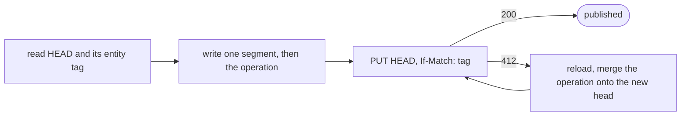

# 0002. Repositories and reviews in the object store, the rest in Postgres

Status: accepted, 2026-10-05. Deciders: jjforge maintainers.

## Context

A repository holds many immutable objects and one small pointer that changes
often: the operation head. Object stores offer two conditional writes.
`If-None-Match: *` creates an object only if it doesn't exist, and `If-Match`
replaces it only if it hasn't changed. SeaweedFS evaluates both atomically
since 4.29, as do S3, GCS, and R2.

| Option                                   | Cost                                                                            |
| ---------------------------------------- | ------------------------------------------------------------------------------- |
| Repositories on local or shared disks    | A repository is tied to a node                                                  |
| Heads in a database or a consensus group | Every push depends on two stateful systems                                      |
| Whole repositories in the object store   | One round trip per write. Chosen                                                |
| One object pool per organization         | A deleted repository's objects wait for a collector, for forks nobody asked for |

The server's modules need lists, filters, joins, unique names, and a read
that sees the write before it. They must later shard by organization without
a rewrite.

| Option                                                       | Cost                                                                            |
| ------------------------------------------------------------ | ------------------------------------------------------------------------------- |
| Server state as event streams, with Postgres as a read model | A read lags its write, and a unique name needs a claim                          |
| Offset pagination, random UUIDs                              | Rows that arrive between pages break the list, and random IDs scatter the index |

Several developers build the server's features in parallel with Spring
Boot, Spring Data, Flyway, and SQL, and one maintainer keeps the Rust code.
jjforge must run on one machine and in a cluster without two code paths.

| Option                                                    | Cost                                                                           |
| --------------------------------------------------------- | ------------------------------------------------------------------------------ |
| vcs offers a storage kernel of streams, names, and leases | Every feature pays for event sourcing, and the Rust maintainer owns a database |
| Microservices from the start                              | Deployment and network failure modes before any module needs them              |
| One binary per role, as Loki, Mimir, and Tempo run        | A flag, a profile, and a chart mode per binary before any role needs to scale  |

vcs must work without the server, as a forge with review and landing, the
way Gerrit works without Zuul. Review and landing read what only vcs holds:
the operation log, the predecessors of each commit, and the head.

| Option                                                    | Cost                                                                   |
| --------------------------------------------------------- | ---------------------------------------------------------------------- |
| Review and landing in the server, over calls to vcs       | vcs can't land on its own, and each decision crosses the network twice |
| Review and landing in vcs, with records in the repository | The Rust code owns features, and a clone carries the reviews. Chosen   |

People have accounts at their organization's identity provider. Agents and
jobs act on their behalf with narrower, short-lived access. A standalone vcs
has no server to issue tokens.

| Option                                    | Cost                                                                                        |
| ----------------------------------------- | ------------------------------------------------------------------------------------------- |
| JWTs signed by the server                 | A standalone vcs needs an OAuth 2.0 server                                                  |
| SSH public keys listed per principal      | vcs keeps the list, and an agent can't get narrower, short-lived access                     |
| SSH certificates from a trusted authority | A browser can't hold one, and narrowing goes back to the authority. Chosen                  |
| Mutual TLS with client certificates       | Every client manages an X.509 certificate, and browsers handle them poorly                  |

## Decision

### Repositories

The object store holds every repository, so vcs is stateless and any replica
serves any repository. Each repository has its own pool:

```text
t/{org}/r/{repo}/pool/seg/{segment}   packed objects
t/{org}/r/{repo}/pool/idx/{segment}   hash to segment and offset, range reads
t/{org}/r/{repo}/op/{hash}            operations and views
t/{org}/r/{repo}/text/{hash}          comment text, one object each
t/{org}/r/{repo}/HEAD                 the current operation and review operation
```

The review log sits next to the operation log under the same `HEAD`, so one
compare-and-swap moves both. The
[review model](../specs/143-review-model.md) specifies its records.



- A segment is immutable and has an index, because each request costs time
  and money. The operation names its segments, so a reader finds any object
  from the log alone.
- A new repository creates `HEAD` with `If-None-Match: *`. No write uses any
  other condition, and the bucket has no versioning.
- Nothing is collected, except that a redaction deletes one comment's text.
  jj keeps every operation, and a deleted repository is
  removed by its prefix. A repository exists in the store before the server
  records it, so an unrecorded `HEAD` is unreachable and costs storage only.

### The server's state

Postgres holds every piece of the server's state: organizations,
repositories, principals, sessions, policy decisions, and whatever later
modules add.

- Each server module owns one schema and migrates it with Flyway. A command
  changes rows and publishes its events in one transaction, so the next read
  sees the write.
- A rule within one module is a constraint, such as a unique index on
  `(org_id, name)`. Work that needs a single owner takes an advisory lock.
- The CloudNativePG operator runs Postgres in the cluster and backs it up to
  the object store, with point-in-time recovery.
- The organization leads every key and index, IDs are UUIDv7, and a
  transaction stays within one tenant. A list answers one page, with an
  opaque `next` cursor while more pages exist. It never answers an offset or
  a total count.

### Boundaries

| Binary | Owns                                                                                                                   | Never                                                                       |
| ------ | ---------------------------------------------------------------------------------------------------------------------- | --------------------------------------------------------------------------- |
| vcs    | The jj backend, `sync/v1`, review, the landing queue, and its rules, in the object store                               | Organizations, sign-in, CI, issues, agents, and indexes across repositories |
| server | Organizations, sign-in, certificates, CI and other gates, issues, agents, and indexes across repositories, in Postgres | Repository storage and review records                                       |

- vcs works without the server, from the repository and the request's
  certificate alone. The server calls vcs through gRPC, and the web app's
  review calls go through the server.
- The server takes part in landing as a gate. vcs runs the queue and waits
  for the verdicts that the repository's landing policy requires.
- The server builds inboxes and searches across repositories from vcs's
  stream. They are derived, so losing them costs a rebuild.
- The server is one Spring Boot app, structured with Spring Modulith. Each
  module is a top-level package, owns one Postgres schema, and reads only its
  own tables. `ModulesTest` fails the build on a dependency that crosses a
  module boundary.
- Modules talk through events. A module publishes a Spring Modulith event in
  the transaction that changes its rows, and the event publication registry
  delivers it after the commit and retries it after a crash. No separate
  event bus runs.
- The server learns about pushes and review records through
  server-streaming calls in `source/v1` and `review/v1`. It keeps the head
  it last saw per repository in Postgres and reads both logs from there, so
  a dropped stream loses nothing.
- Each binary runs every role it has. The chart runs one Deployment of each
  and scales each by replica count. A split by role waits for a measurement
  that asks for it.
- The object store is a URL: `s3://` with the twins, `file://` for vcs on its
  own.
- The infra repository runs SeaweedFS and Postgres in the cluster. The chart
  takes their connection configuration and installs neither.
  `shared/deploy/compose.yaml` runs both binaries with the twins of
  [ADR 0004](0004-specified-tested-built.md).
- No cache service until a requirement needs one, measured. Every replica
  caches immutable objects in memory and on local disk.

### Certificates

- Every principal proves who it is with an OpenSSH user certificate. Its
  key ID names the principal, its validity bounds the access, and its
  extensions carry the scopes and the delegation chain.
- vcs trusts the certificate authorities its configuration lists, each for
  the organizations it names. `jf` signs a challenge from vcs and the origin
  it connected to, with ssh-agent, and gets a session of at most 15
  minutes, so a cache can serve object reads. vcs refuses an origin that
  isn't its own, so another site can't relay its challenge.
- On its own, an administrator signs keys with `ssh-keygen -s`. With the
  server, the server is the authority: a person signs in through the
  organization's provider and gets a certificate for hours, an agent a
  narrower one for minutes.
- A browser signs in to the server, which calls vcs with its own certificate
  and names the person in the delegation chain.
- jjforge stores no passwords. Cedar holds the server's policy, and every
  decision is recorded with the policy that made it. The landing rules live
  in the repository.
- Revocation takes effect when the session expires.

## Consequences

- A push costs one conditional request, 20 to 200 ms on most stores, and
  never touches Postgres.
- Losing either store loses data, so both have backups and a restore drill.
- A migration is permanent. A wrong one is fixed by another migration.
- Writes stop at one primary. A module's schema can move to an instance of
  its own when it gets there.
- A query that spans organizations reads from events or a projection.
- When a requirement names a fork, it copies the objects or references the
  segments of its parent. Both change this record.
- A rule that spans modules goes through events, and holds a moment after
  the commit, not in it.
- A module can move into its own service by taking its schema and its events
  with it.
