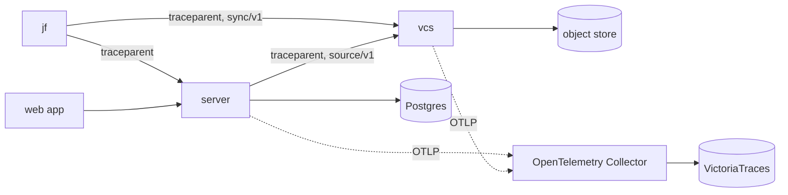

# 0005. Logs, traces, and metrics through OpenTelemetry

Status: proposed, 2026-10-07. Deciders: jjforge maintainers.

## Context

A request crosses `jf` or the browser, the server, vcs, Postgres, and the
object store. When it fails or is slow, the people who run jjforge must find
where, starting from a trace ID that a person quotes. Today the server
exposes Prometheus metrics through Micrometer and vcs through the `metrics`
crate. vcs logs with `println!`, and no binary records a trace.

The infra repository runs VictoriaMetrics with 90 days of metrics,
VictoriaLogs with 30 days of logs collected from container stdout, and
Grafana. It runs no trace store.

- A `VMPodScrape` reads both binaries through the chart's ports named
  `management` and `metrics`. The alert `JjforgeServerErrors` reads
  Micrometer's `http_server_requests_seconds_count`, and `TargetDown` fires
  when a binary stops answering the scrape.
- An app's namespace sends nothing outside itself except DNS queries and
  calls to the API server. The observability namespace admits only itself,
  Traefik, and the API server. A scrape reaches jjforge, and nothing jjforge
  sends reaches a store.

The measurement store in the
[architecture](../architecture.md#building-blocks) measures the software that
people build on jjforge. This record covers telemetry about jjforge itself.

| Option                                                                    | Cost                                                  |
| ------------------------------------------------------------------------- | ----------------------------------------------------- |
| Each language's own tools, Prometheus, and no traces                      | No request can be followed from one binary to another |
| A vendor's agent and backend                                              | Lock-in, and a bill per host                          |
| OpenTelemetry, with OTLP, W3C Trace Context, and the semantic conventions | The Rust trace SDK is beta and still breaks. Chosen   |

| Option for the server                                                                      | Cost                                                                                  |
| ------------------------------------------------------------------------------------------ | ------------------------------------------------------------------------------------- |
| The OpenTelemetry Java agent                                                               | A second instrumentation next to Micrometer, matched by version to Spring, and no AOT |
| `spring-boot-starter-opentelemetry`, which bridges Micrometer Observation to OpenTelemetry | Chosen                                                                                |

| Option for vcs and `jf`                                                                 | Cost                                                                                       |
| --------------------------------------------------------------------------------------- | ------------------------------------------------------------------------------------------ |
| The OpenTelemetry API for spans and `tracing` for events, as opentelemetry-rust advises | tonic emits `tracing` spans, which the export would miss                                   |
| `tracing`, exported through `tracing-opentelemetry`                                     | A bridge outside the OpenTelemetry project, which calls it a workaround at an edge. Chosen |

| Option for logs                                  | Cost                                                                                           |
| ------------------------------------------------ | ---------------------------------------------------------------------------------------------- |
| OTLP from each binary                            | The server needs a third-party Logback bridge, and a crash loses the lines still in the buffer |
| JSON lines on stdout, which the cluster collects | Each binary writes the trace ID into the line itself. Chosen                                   |

| Option for metrics  | Cost                                                                       |
| ------------------- | -------------------------------------------------------------------------- |
| OTLP, pushed        | A network path out of each namespace, new alerts, and no `up` series       |
| Prometheus, scraped | A second transport next to OTLP. Chosen, because the cluster scrapes today |

| Option for the trace store | Cost                                                                          |
| -------------------------- | ----------------------------------------------------------------------------- |
| Grafana Tempo              | A second vendor's stack next to VictoriaMetrics and VictoriaLogs              |
| VictoriaTraces             | Before 1.0, its storage format may change. Chosen, because traces live 7 days |

## Decision

### Signals

| Signal | Answers                                                    | Transport            | Store           | Retention                   |
| ------ | ---------------------------------------------------------- | -------------------- | --------------- | --------------------------- |
| Trace  | Where one request spent its time, and where it failed      | OTLP                 | VictoriaTraces  | 7 days                      |
| Metric | How many, how fast, and how full, over time                | Prometheus, scraped  | VictoriaMetrics | 90 days                     |
| Log    | What a process did that its spans and metrics don't record | JSON lines on stdout | VictoriaLogs    | 30 days                     |
| Audit  | Who did what                                               | A row and its event  | Postgres        | As long as its organization |

- Telemetry is expendable. A fact that must last is a Postgres row, as
  [ADR 0002](0002-state-boundaries-and-tokens.md) decides.
- The infra repository runs the stores and the network path to them. The
  chart installs none. `shared/deploy/compose.yaml` runs VictoriaTraces as
  the twin.
- No signal holds a secret, a token, a credential header, a request body,
  repository content, or personal data. A principal appears as its ID, a
  span names a route template and never a query string, an object store key
  holds only IDs and hashes, and SQL runs with parameters. Nothing redacts
  at the Collector, so the rule rests on the instrumentation.

### Traces

- The chart passes `OTEL_EXPORTER_OTLP_TRACES_ENDPOINT`. Without it a binary
  exports nothing. The endpoint is a Collector in the infra repository that
  only receives, because the trace store serves reads and deletes on its
  write port.
- `service.name` is `jjforge-server` or `jjforge-vcs`, `service.version` the
  release, and the chart sets `deployment.environment.name`.
- Only W3C Trace Context travels. Baggage stays off, because every binary
  would forward what a caller sets.
- Tracing is cross-cutting: the libraries and one module per binary trace
  every request, and the checks refuse tracing code elsewhere. The server
  uses `spring-boot-starter-opentelemetry`. vcs uses `tracing` with
  `tracing-opentelemetry`, and its `telemetry` module starts the span of
  every gRPC call and `sync/v1` request.
- `jf` exports nothing, because it runs on people's machines. It starts a
  trace per command and sends `traceparent` with every request.
- The web app sends no trace context while the browser instrumentation is
  experimental.
- The server names each response's trace in `traceresponse`. `jf` prints its
  trace ID on failure and the web app shows the header's, so a person can
  quote it.
- Every binary records every span, whatever the sampled flag of an incoming
  `traceparent` says, and keeps the caller's trace ID, so the ID that `jf`
  prints finds the request. Only the Collector reduces volume, behind a tier
  that routes by trace ID, and it keeps every trace with an error or a
  refusal first.
- Every request is traceable. Each gRPC method and HTTP route has a server
  span, one wide event of who, where, what, and how it ended:
  `jjforge.principal.id`, `jjforge.org.id`, `jjforge.repo.id`, and on
  refusal `jjforge.refusal`. A call without a repository, such as
  `echo/v1`, names what it did.
- Each call that leaves a binary gets a client span. Work outside a request,
  such as a job or a listener, gets a span of its own.
- In vcs, only the store crate's `server` side adds spans below the request:

| Span                       | Attributes                                                                                                                       |
| -------------------------- | -------------------------------------------------------------------------------------------------------------------------------- |
| `repo head`                | `jjforge.operation.id`                                                                                                           |
| `repo operations`          | `jjforge.operation.since`, `jjforge.operations.count`                                                                            |
| `repo missing`             | `jjforge.ids.asked`, `jjforge.ids.missing`                                                                                       |
| `repo fetch`               | `jjforge.ids.asked`, `jjforge.fetch.bytes`                                                                                       |
| `repo upload`              | `jjforge.upload.objects`, `jjforge.upload.bytes`, `jjforge.segment.id`                                                           |
| `repo publish`             | `jjforge.operation.expected`, `jjforge.publish.bookmarks`, `jjforge.publish.segments`, `jjforge.publish.outcome`, `jjforge.operation.id` |
| `advance`                  | `jjforge.operations.read`                                                                                                        |
| `echo`                     | `jjforge.echo.bytes`                                                                                                             |
| `object_store {operation}` | `jjforge.object_store.operation`, `jjforge.object_store.key`, and on a write `jjforge.object_store.bytes`, `jjforge.object_store.swap` |

- The outcome of a publish is `moved`, `unchanged`, or `stale`, with
  `HEAD` after it in `jjforge.operation.id`. A count never names what it
  counts.

### Metrics

- The chart keeps the ports named `management` and `metrics`, which the
  infra scrape selects.
- A library's metric keeps its name, because the infra alerts read it. One
  of jjforge's own takes its name from the semantic conventions, or starts
  with `jjforge.`, such as `jjforge.push.conflicts`.
- A label takes values from a set the code bounds. An ID never labels a
  metric.

### Logs

Each binary writes one JSON object per line to stdout, with `message`, and
`trace_id` and `span_id` inside a span. A message is a constant, and what
varies goes in fields.

| Line                    | When                                                                                                                                                            | Level |
| ----------------------- | --------------------------------------------------------------------------------------------------------------------------------------------------------------- | ----- |
| `request`               | Each request ends. Route or method, status, outcome, refusal reason, duration, and its organization, repository, and principal. It repeats the span on purpose, so the record survives a lost, sampled, or expired trace | INFO  |
| An event                | A step changed a request's course, such as a retry, a lost race, a cache that starts over, or a reload                                                          | INFO, or WARN when unexpected |
| A failure               | The binary itself failed                                                                                                                                        | ERROR |
| Start, stop             | The process starts, stops, or can't run. The only lines outside a span                                                                                          | INFO  |

- A line inside a request carries its trace, so trace views show it on the
  span, and the request's organization, repository, and principal. This
  follows OpenTelemetry, which deprecates span events in favor of such log
  records.
- No line narrates, such as one on entering a function, and none repeats
  the span apart from `request`. A client error writes nothing beyond
  `request`.
- A refusal's `request` line names the reason: `unauthenticated`,
  `forbidden`, or `hidden` for an organization the principal may not see.
  It's the refusal's only record, kept 30 days, until an audit spec makes
  refusals rows.
- DEBUG is off where jjforge is deployed, and turned on per logger.

vcs writes these events:

| Event                 | Span                | When                                                       |
| --------------------- | ------------------- | ---------------------------------------------------------- |
| `key sets reload`     | the request's       | A token names an unknown key, so vcs fetches the key sets  |
| `catalog starts over` | `advance`           | A repository was created again under the same IDs, at WARN |
| `swap lost`           | `object_store swap` | Another writer moved `HEAD` first                          |

### Checks

| Rule                                                                              | Check                                                                                                                    |
| --------------------------------------------------------------------------------- | ------------------------------------------------------------------------------------------------------------------------ |
| The server logs through SLF4J, never `System.out` or `java.util.logging`          | `ArchitectureTest`, ArchUnit                                                                                             |
| vcs logs through `tracing`, never `println!` or `eprintln!`                       | clippy `print_stdout` and `print_stderr`                                                                                 |
| Only the server's `telemetry` module uses a tracing API                           | `ArchitectureTest`, ArchUnit                                                                                             |
| Every response of the server names its trace                                      | `TraceResponseTest`                                                                                                      |
| Only `forge::Client` builds an HTTP client in `jf`                                | clippy `disallowed-methods`                                                                                              |
| A request with `traceparent` has spans of the server and vcs under its trace      | `mise run e2e`, which queries the twin                                                                                   |
| Each gRPC method and `sync/v1` route of vcs has a span with its context           | `every_call_is_traceable_with_its_org_repo_and_principal` and `every_route_is_traceable_with_its_org_repo_and_principal` |
| vcs records a request whatever its sampled flag                                   | `a_caller_can_not_turn_off_its_trace`                                                                                    |
| A request of vcs writes one `request` line                                        | `a_request_writes_one_line_when_it_ends` and `a_grpc_call_writes_one_line_when_it_ends`                                  |
| A line inside a request carries its context                                       | `a_line_inside_a_request_carries_its_context`                                                                            |
| A refusal names its principal and reason                                          | `a_refused_request_names_who_asked`                                                                                      |
| An event of vcs falls inside a span                                               | `finished_spans` fails a test on an event outside one, and a vcs or store test per event                                 |
| A failure of vcs writes an ERROR line                                             | `a_server_error_that_axum_answers_writes_a_line`                                                                         |

## Consequences

- Traces wait for the infra repository to run VictoriaTraces and the
  Collector, open the path to it, and link `trace_id` in VictoriaLogs.
- An upgrade of VictoriaTraces before 1.0 may discard up to 7 days of
  traces. Logs live 30, so an older line's `trace_id` finds no trace.
- A caller chooses its trace ID, so it can join a trace whose ID it knows.
  A trace ID is 128 random bits, and a person learns only their own.
- The server doesn't follow these rules yet: it samples by its parent,
  writes no `request` line, and names no organization, repository, or
  principal until it authenticates, as #6 plans.
- An `@ApplicationModuleListener` runs on another thread after its request.
  Its span joins the request's trace only once the server propagates the
  context, and an event republished after a restart starts a new trace. A
  test holds this once a module publishes its first event.
- `traceresponse` comes from Trace Context Level 2, which isn't final.
- Traces that `jf` starts lack their root span, which some views flag.
- No metric carries an exemplar yet, so a latency spike leads to traces
  only through a search by time.
- A SQL client span needs an instrumented data source, chosen with the first
  module that uses Postgres.
- Once the opentelemetry-rust trace SDK is stable, vcs moves its edges to
  it and this record changes.
- No check holds the label rule or the secrets rule yet.
