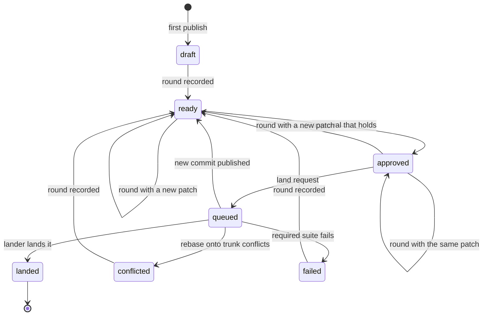
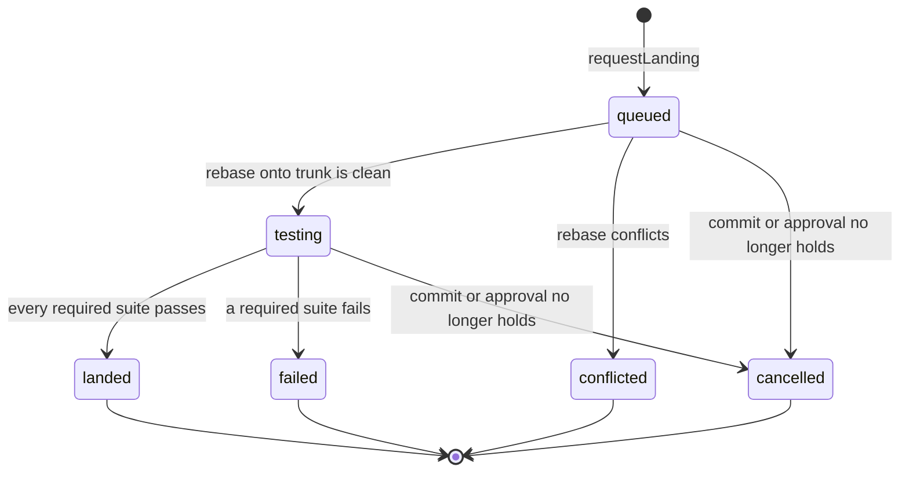
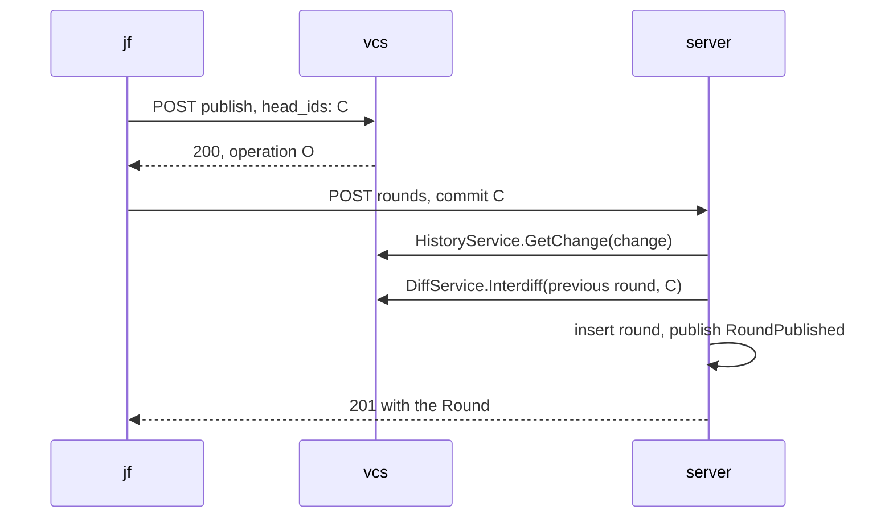
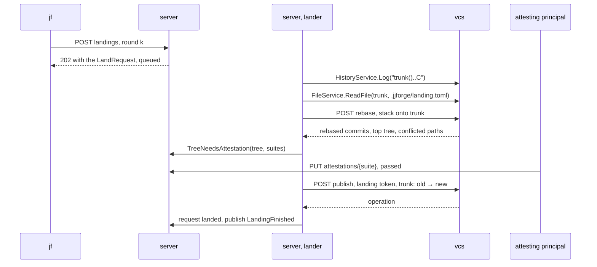
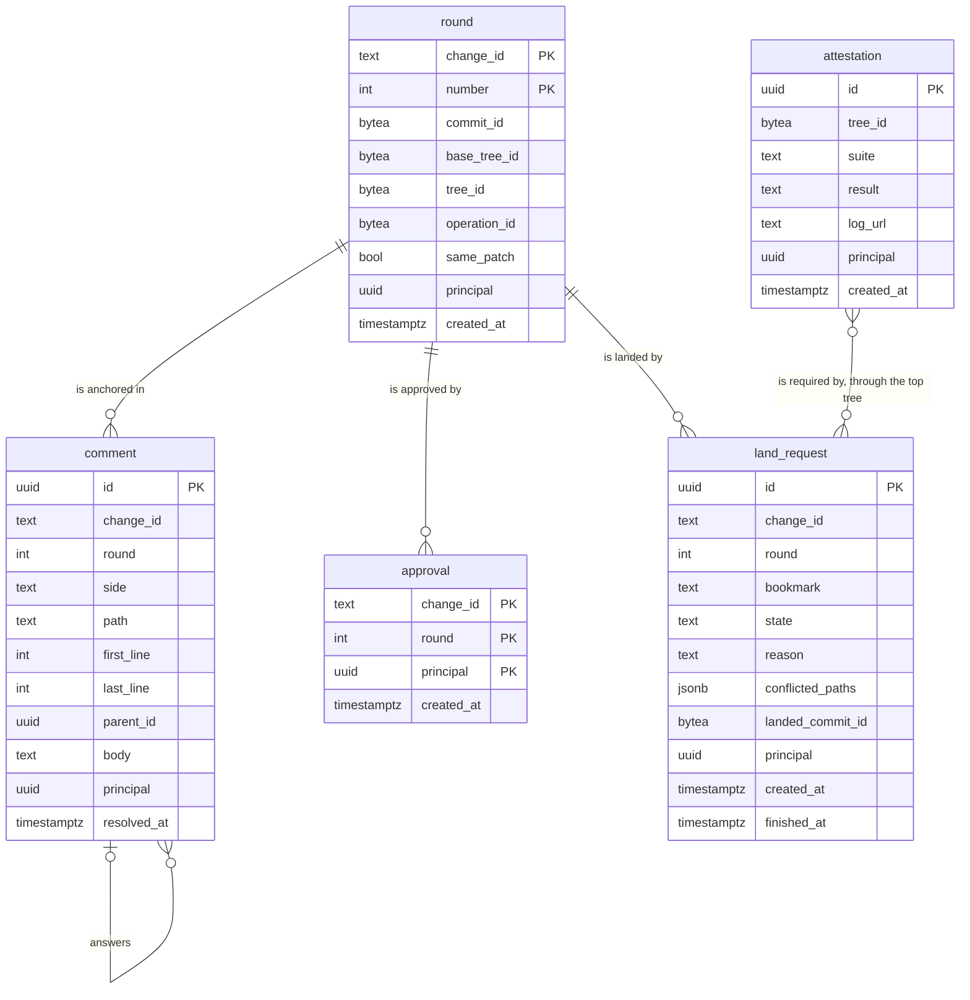

# Review model

The records that review and landing share: rounds, comments, approvals,
attestations, and land requests, for
[#143](https://github.com/nca-apprentices/jjforge/issues/143). It comes before
[#58](https://github.com/nca-apprentices/jjforge/issues/58),
[#59](https://github.com/nca-apprentices/jjforge/issues/59),
[#60](https://github.com/nca-apprentices/jjforge/issues/60), and
[#65](https://github.com/nca-apprentices/jjforge/issues/65), whose pages
specify only their own requirements and link this page. The server's
`review` and `landing` modules own it, as
[ADR 0002](../adr/0002-state-boundaries-and-tokens.md) decides. vcs adds two
primitives and no feature. The repository stays native jj, as
[ADR 0001](../adr/0001-native-jj-without-git.md) decides.

## Summary

A change is the unit of review. There is no pull request. The owner marks a
commit of the change ready, which records a round. Reviewers comment on the
round's lines and approve its patch. An approval survives a new round whose
patch is the same, such as a rebase, and lapses on any change of content. A
land request hands the change to the lander, the only principal that moves
trunk. The lander rebases the change onto trunk on the forge, tests the
result, and lands it with the same change ID, so every clone sees the old
commit replaced.

## Motivation

M2 moves jjforge's own review off GitHub. GitHub reviews a branch. A
rewritten commit gets a new SHA, so GitHub loses track of what was approved,
and a force push leaves no record of the earlier version. jj already keeps
what review needs: a change ID that survives rewrites, the earlier versions
of each change in the operation log, and conflicts stored in commits. A
forge that reviews branches throws that away.

Four epics need the same records. Rounds and interdiffs
([#58](https://github.com/nca-apprentices/jjforge/issues/58)), the landing
queue ([#59](https://github.com/nca-apprentices/jjforge/issues/59)),
conflicts as work items
([#60](https://github.com/nca-apprentices/jjforge/issues/60)), and change
ownership ([#65](https://github.com/nca-apprentices/jjforge/issues/65)) each
read rounds and approvals. Specifying them one by one would define the
records four times.

Goals, each one a demo can show:

- A rebase that changes no content keeps its approval, and an edit drops it.
- The interdiff between two rounds shows only what the owner changed, never
  what trunk changed underneath.
- A comment stays on its line across rounds, or shows as outdated when its
  lines are gone.
- trunk only ever points at a commit whose tree passed the required suites.
- A conflict at landing leaves the queue moving and gives the owner a work
  item that names the conflicted paths.

## Guide

`acme_owner` and `acme_member` work on the repository `acme/forge`.

### Ask for review

`acme_owner` writes a change on trunk and marks it ready. `jf review ready`
publishes the commit as a visible head, then records round 1.

```console
$ jf new trunk() -m "Count rounds from one"
$ jf review ready
Published kmpsxqvo 3f9a1c2e
Round 1 of kmpsxqvo is ready: 3f9a1c2e on trunk 9b04d7e1
```

The change ID `kmpsxqvo` names the change in every later command. The
commit ID `3f9a1c2e` names this version of it.

### Review a round

`acme_member` reads the round, comments on a line, and approves.

```console
$ jf review show kmpsxqvo
kmpsxqvo  Count rounds from one  acme_owner  round 1 of 1
  src/round.rs  +14 -2
$ jf review comment kmpsxqvo --path src/round.rs --line 12 -m "Can k be 0 here?"
Comment c1 on round 1, src/round.rs:12
$ jf review approve kmpsxqvo
Approved round 1 of kmpsxqvo
```

The approval names the round, so it holds for that round's patch: the
difference between the tree of the commit and the tree of its parents.

### Answer with a new round

`acme_owner` fixes the line and marks the change ready again. The content
changed, so the approval lapses.

```console
$ jf edit kmpsxqvo
$ jf review ready
Round 2 of kmpsxqvo is ready: 7d21c0aa on trunk 9b04d7e1
Approval by acme_member on round 1 lapsed: the patch changed
$ jf review show kmpsxqvo --interdiff 1..2
  src/round.rs  +1 -1
  c1 src/round.rs:12 carried to line 12
```

`acme_member` approves round 2. Meanwhile trunk moves, so `acme_owner`
rebases and marks round 3. The rebase changes no content, so the approval
carries over.

```console
$ jf rebase -r kmpsxqvo -d trunk()
$ jf review ready
Round 3 of kmpsxqvo is ready: e5b8f312 on trunk 41c6aa90
Approval by acme_member on round 2 carried: the patch is the same
```

### Land

`acme_owner` asks to land round 3. The lander rebases it onto trunk, waits
for the required suites, and lands it.

```console
$ jf land kmpsxqvo
Land request l7 for round 3 of kmpsxqvo: queued
$ jf land --watch l7
queued   → testing  tree 0c9e41b7, suite check
testing  → landed   kmpsxqvo a4f07d55 on trunk
$ jf fetch
$ jf log -r kmpsxqvo
◆  kmpsxqvo acme_owner a4f07d55 trunk
│  Count rounds from one
```

The landed commit `a4f07d55` keeps the change ID and records `e5b8f312` as
its predecessor. jj hides the replaced commit in the clone, and rebases any
of `acme_owner`'s local changes on top of it.

### Hit a conflict

Had trunk changed the same lines, the lander would report the conflict and
take the next request.

```console
$ jf land --watch l7
queued   → conflicted  src/round.rs
$ jf rebase -r kmpsxqvo -d trunk()
$ jf resolve
$ jf review ready
Round 4 of kmpsxqvo is ready: 18aa3c09 on trunk 77e2b0c4
```

## Model

### Objects

| Object       | Identified by                      | Holds                                                                     | Stored or derived                                                 |
| ------------ | ---------------------------------- | ------------------------------------------------------------------------- | ----------------------------------------------------------------- |
| Change       | change ID                          | Its commits, in the operation log                                         | vcs stores it. The server reads it                                |
| Owner        | change ID                          | The principal of the first operation that published the change            | Derived from the operation log, as #65 decides                    |
| Round        | change ID and round number         | The commit, its base tree, its tree, and the operation                    | Stored. The commit and the trees are immutable                    |
| Patch        | a round                            | The base tree and the tree                                                | Derived from the round                                            |
| Interdiff    | two rounds of one change           | The earlier patch rebased onto the later base, diffed with the later tree | Derived on read. Whether it is empty is stored on the later round |
| Comment      | UUIDv7                             | The round, the side, the path, the lines, the body, and a parent comment  | Stored. Its place in a later round is derived                     |
| Approval     | change ID, round number, principal | The principal and the time                                                | Stored. Whether it holds is derived                               |
| Attestation  | tree ID and suite                  | The result, a log address, and the principal                              | Stored, append only. The latest one by a trusted principal counts |
| Land request | UUIDv7                             | The round, the target bookmark, and its state                             | Stored. Its state moves only in the lander                        |

The base tree of a commit is the merge of its parents' trees, which jj
computes for every diff it shows. A patch is therefore what `jf diff -r` on
the round's commit shows.

### Invariants

1. A round's commit is the change's only visible commit when the round is
   recorded. `publishRound` checks it, and refuses a divergent change.
2. Round numbers of a change start at 1 and have no gaps. The primary key
   `(org_id, repo_id, change_id, number)` and the insert of `max + 1` in one
   transaction enforce it.
3. An approval on round j holds for round k ≥ j when every round from j + 1
   to k has an empty interdiff with the round before it. The query in
   [Persistence](#persistence) computes it, and nothing stores it.
4. An attestation describes a tree, never a commit. Two commits with one
   tree share every attestation.
5. Only the lander moves trunk, and only with the landing token. vcs refuses
   any other move of a protected bookmark, as
   [ADR 0001](../adr/0001-native-jj-without-git.md) decides.
6. The landed commit keeps the change ID and names the requested commit as
   its predecessor, so every clone replaces one with the other.
7. trunk only points at a tree with a passing attestation for every
   required suite. The lander checks it in the step that moves trunk.
8. The landing policy, meaning the required suites, the trusted attesting
   principals, and the time limit, comes from `.jjforge/landing.toml` in the
   tree of trunk's target, never from the tree being landed. A change that
   edits the policy lands under the old one. Zuul and bors read their
   configuration from the target branch too.

### A change in review

The state of a change is derived from its rounds, approvals, land requests,
and its visible commit. Nothing stores it.



### A land request



A request in a final state never moves again. The owner asks for a new one.

### Stacks

A land request on a change lands the stack `trunk()..X` in order. Each
change in the stack needs its own approval that holds and its latest
round's commit visible. The required suites run on the tree of X, the top
of the stack, because trunk moves straight to X and never points at the
changes between.

## Out of scope

- A policy language. M2 requires one approval by a member other than the
  owner, and the suites that `.jjforge/landing.toml` on trunk names.
  Policy as revsets and filesets waits for
  [#76](https://github.com/nca-apprentices/jjforge/issues/76).
- Running the suites. A principal with the `attest` scope reports results.
  Sandboxes that run them come with
  [#69](https://github.com/nca-apprentices/jjforge/issues/69).
- Gates that veto a landing, which
  [#68](https://github.com/nca-apprentices/jjforge/issues/68) adds.
- Notifications of a new round or comment.

## Flow

### Record a round

Operation `publishRound` by principal P, from `jf review ready`.



1. Publish: `jf` publishes C as a visible head through `sync/v1`, as
   [#29](https://github.com/nca-apprentices/jjforge/issues/29) specifies. A
   commit already visible publishes nothing.
2. Token: the server verifies the token. Refused: 401 `unauthenticated`. A
   principal outside the organization gets 404 `not_found`.
3. Owner: P owns the change. Refused: 403 `not_owner`.
4. Commit: `GetChange` answers C as the change's only visible commit.
   Refused: 409 `divergent` when the change has several, and 409
   `stale_commit` when C isn't the visible one.
5. Interdiff: the server asks vcs whether the patch of C equals the patch of
   the previous round's commit, and stores the answer as `same_patch`.
6. Insert: one transaction inserts the round with number `max + 1` and
   publishes `RoundPublished`. A concurrent insert of the same number fails
   the primary key, and the server retries once.

### Comment and approve

Operations `createComment` and `approveRound` by principal P.

1. Token and membership, as in [Record a round](#record-a-round).
2. Round: the round exists. Refused: 404 `not_found`.
3. Approval only: P isn't the owner. Refused: 403 `self_approval`.
4. Insert: one transaction inserts the row and publishes `CommentAdded` or
   `ApprovalGiven`. A second approval by P of the same round answers 200 and
   inserts nothing.

### Land

Operation `requestLanding` by principal P, then the lander.



The request:

1. Token, membership, and owner, as in [Record a round](#record-a-round).
2. Round: round k is the change's latest round. Refused: 409
   `stale_round`.
3. Approval: an approval holds for round k. Refused: 409 `not_approved`.
4. Insert: one transaction inserts the request as `queued` and publishes
   `LandingRequested`. The answer is 202, because the lander does the rest.

The lander takes the oldest queued request per repository and bookmark,
under an advisory lock, as
[ADR 0002](../adr/0002-state-boundaries-and-tokens.md) gives for work with
a single owner. It re-reads every fact at each step instead of trusting an
event, so a missed or repeated event changes nothing:

1. Holds: each change in `trunk()..C` has its latest round's commit visible
   and an approval that holds. Otherwise the request moves to `cancelled`
   with the reason.
2. Policy: the lander reads `.jjforge/landing.toml` from the tree of
   trunk's target, as invariant 8 gives.
3. Rebase: `POST {base}/rebase` in `sync/v1` rebases the stack onto trunk's
   target and writes the rebased commits and their trees, without an
   operation. A conflict moves the request to `conflicted` with the paths,
   and the lander takes the next request.
4. Test: for each required suite, the latest attestation of the top tree
   by a principal the policy trusts. A missing one publishes
   `TreeNeedsAttestation` and leaves the request in `testing` until
   `AttestationRecorded` wakes the lander. A failed one moves the request
   to `failed`.
5. Land: the lander publishes through `sync/v1` under the landing token,
   as [ADR 0001](../adr/0001-native-jj-without-git.md) gives for a
   protected bookmark. The `PublishRequest` moves trunk from its target to
   the top rebased commit, hides the requested commits, and names them as
   the predecessors of the rebased ones. These are the commits the suites
   tested, so nothing is rebased twice. Refused: 412
   `precondition_failed` when another publish moved the head, and the
   lander merges and publishes again. Only the lander moves trunk, so
   trunk's target can't change in between.
6. Record: one transaction marks the request `landed` with its commit and
   publishes `LandingFinished`.

### Fetch after landing

`jf fetch` merges the operation of the lander with
`RepoLoader::merge_operations`, as
[#29](https://github.com/nca-apprentices/jjforge/issues/29) specifies. The
operation names each requested commit as the predecessor of a landed one,
so jj hides the requested commit and rebases its local descendants onto the
landed one.

## Persistence

Postgres holds every record, in the schemas `review` and `landing`, as
[ADR 0002](../adr/0002-state-boundaries-and-tokens.md) decides. Each key
starts with `org_id` and `repo_id`, which the diagram leaves out.



- `review.round`, `review.comment`, and `review.approval` belong to the
  `review` module. `landing.attestation` and `landing.land_request` belong
  to `landing`, which reads rounds and approvals through the `review`
  module's `ReviewQueries`.
- The approvals that hold for round k of a change: the approvals of rounds
  j ≤ k for which no round in `j + 1 .. k` has `same_patch` false.
- The latest attestation of a tree and a suite by a trusted principal:
  `where principal = any(:trusted)` on an index of
  `(org_id, repo_id, tree_id, suite, principal, created_at desc)`. A row by
  any other principal never answers, even when it is newer.
- The queue: a partial index on `land_request (org_id, repo_id, bookmark,
  created_at) where state in ('queued', 'testing')`.

| Event                  | Published by | Listeners                                             |
| ---------------------- | ------------ | ----------------------------------------------------- |
| `RoundPublished`       | `review`     | `landing`, which cancels a request for an older round |
| `CommentAdded`         | `review`     | None yet                                              |
| `ApprovalGiven`        | `review`     | None yet                                              |
| `LandingRequested`     | `landing`    | The lander                                            |
| `TreeNeedsAttestation` | `landing`    | Attesting principals, over SSE                        |
| `AttestationRecorded`  | `landing`    | The lander                                            |
| `LandingFinished`      | `landing`    | None yet                                              |

The object store gains nothing but commits and trees. `POST {base}/rebase`
writes the ones it computes, and a commit that never lands costs storage
only, as
[ADR 0002](../adr/0002-state-boundaries-and-tokens.md) gives for every
unreachable object.

## Architecture

| Binary | Module or crate | Item                    | Kind    | Role                                                                                                                      |
| ------ | --------------- | ----------------------- | ------- | ------------------------------------------------------------------------------------------------------------------------- |
| server | `review`        | `ReviewCommands`        | service | Records rounds, comments, and approvals.                                                                                  |
| server | `review`        | `ReviewQueries`         | service | Answers rounds, comments with their place in a later round, and the approvals that hold.                                  |
| server | `landing`       | `LandingCommands`       | service | Records land requests and attestations.                                                                                   |
| server | `landing`       | `Lander`                | worker  | Runs the queue of each repository and bookmark under an advisory lock.                                                    |
| vcs    | `source`        | `DiffService.Interdiff` | call    | Rebases the patch of one commit onto the base of another and diffs the trees, as `jj interdiff` does.                     |
| vcs    | `sync`          | `POST {base}/rebase`    | route   | Rebases a stack onto a commit, writes the commits and trees, and answers them with the top tree and the conflicted paths. |
| `jf`   | `commands`      | `review`, `land`        | module  | The commands of the [Guide](#guide), over REST.                                                                           |

vcs gains one read in `source/v1` and one write in `sync/v1`, so
`source/v1` stays read only, as
[ADR 0002](../adr/0002-state-boundaries-and-tokens.md) decides. The rebase
route writes objects and no operation, and trunk moves only through a
`sync/v1` publish under the landing token, as
[ADR 0001](../adr/0001-native-jj-without-git.md) decides. Every decision
about rounds and approvals stays in the server, so vcs still holds nothing a
person would call a feature.

External systems and their twins in `shared/deploy/compose.yaml`: Postgres
as `postgres`, and the object store as `seaweedfs`. The epic adds none.

## Compatibility

- Every REST route, `sync/v1` route, and `source/v1` call is new, so
  `/api/v1/` and `buf breaking` see additions only. Landing reuses the
  existing `PublishRequest`.
- An older `jf` pushes and fetches as before. It lacks `review` and `land`,
  and the web app offers both.
- `store.v1` doesn't change. A landed commit is an ordinary commit with
  predecessors in its operation.

## Operations

- The lander exports the queue length per repository, the time from
  request to final state, and the share of attestations found on the first
  look, through OpenTelemetry as
  [ADR 0005](../adr/0005-telemetry-through-opentelemetry.md) proposes.
- Throughput per bookmark is one landing per suite run, because the queue is
  serial. A cached tree costs no run.

## Security

- The server decides ownership from the operation log, never from the
  request. A principal can't record a round of a change it doesn't own.
- Only the lander holds the landing token. vcs refuses a protected bookmark
  move from any other token, even one with write scope.
- An attestation names its principal. Only a principal with the `attest`
  scope writes one, and the lander counts only attestations from the
  principals that `.jjforge/landing.toml` names.
- The lander reads the policy from trunk's target, never from the tree it
  lands, so a change can't relax the suites or trust another principal to
  land itself. A change to the policy takes effect once it is on trunk.
- `POST {base}/rebase` needs write scope on the repository. Its commits stay
  unpublished, so it changes nothing another person sees.
- A comment body is text. The web app renders it as Markdown without HTML.

## Failures

A crash after `jf` publishes the commit and before the round is recorded
leaves a visible commit without a round. `jf review ready` again records
it.

A crash during `POST {base}/rebase` leaves commits and trees that nothing
names. The
lander starts the request over after it takes the lock again.

A crash after the publish moves trunk and before the request is
marked `landed` leaves a request in `testing` whose change is on trunk. The
lander finds the landed commit through the change ID on its next pass and
marks the request `landed`.

An attesting principal that never answers leaves a request in `testing`.
The request is cancelled after the time the policy gives, and
the lander takes the next one.

## Alternatives

### Where the records live

| Option                                                                                  | Cost                                                                                                                                                         |
| --------------------------------------------------------------------------------------- | ------------------------------------------------------------------------------------------------------------------------------------------------------------ |
| In the repository, as a second log that clones fetch, as NoteDb keeps reviews in Gerrit | A new object kind in `store.v1`, union merges of concurrent records, and vcs owning a feature against [ADR 0002](../adr/0002-state-boundaries-and-tokens.md) |
| In Postgres, keyed by change ID and the immutable IDs of commits and trees              | A clone can't read a review offline. Chosen                                                                                                                  |

Every key is an immutable ID, so moving the records into the repository
later copies rows without translating them.

### What an approval binds to

| Option                         | Cost                                                               |
| ------------------------------ | ------------------------------------------------------------------ |
| The commit                     | Every rebase drops it, as GitHub's dismissal of stale reviews does |
| The tree                       | Every move of trunk under the change changes the tree and drops it |
| The patch, carried while equal | One interdiff per round. Chosen                                    |

### Who rebases at landing

| Option                                       | Cost                                                                         |
| -------------------------------------------- | ---------------------------------------------------------------------------- |
| The owner, until the change is current       | Owners race each other, and each lost race costs a suite run                 |
| The lander, on the forge                     | The lander rewrites a change it doesn't own, under the landing token. Chosen |

### Where the landing writes go

| Option                                                  | Cost                                                                                                      |
| ------------------------------------------------------- | --------------------------------------------------------------------------------------------------------- |
| Write calls in `source/v1` that rebase and move trunk   | Edits ADR 0002, which keeps `source/v1` read only, and ADR 0001, which moves trunk only through a publish |
| The lander as its own jj-lib replica, publishing to vcs | A third binary, or jj-lib in the server, for one worker                                                   |
| A rebase route in `sync/v1`, then an ordinary publish   | Any client with write scope can ask vcs to rebase. Chosen                                                 |

### Where the landing policy comes from

| Option                     | Cost                                                                                           |
| -------------------------- | ---------------------------------------------------------------------------------------------- |
| The tree being landed      | A change can relax its own suites or trust a principal its owner controls                      |
| Trunk's target tree        | A change to the policy waits one landing before it applies. Chosen. Zuul and bors do the same  |
| A setting in Postgres      | Policy outside the repository has no review and no history                                     |

### What a landing tests

| Option                                      | Cost                                                           |
| ------------------------------------------- | -------------------------------------------------------------- |
| Each round only                             | Two changes that pass alone can break trunk together           |
| The rebased top tree, one request at a time | One suite run per landing bounds throughput. Chosen            |
| Batches tested speculatively                | Bisecting a failed batch, and a queue that is harder to follow |

### What a conflict at landing does

| Option                                        | Cost                                                                                      |
| --------------------------------------------- | ----------------------------------------------------------------------------------------- |
| Stop the queue until it is resolved           | One conflict blocks every other change                                                    |
| Publish the conflicted rebase as a new commit | The forge rewrites the owner's change, and the owner's clone diverges from what they edit |
| Record it on the request and move on          | The owner rebases and resolves locally. Chosen                                            |

### One operation head or one per actor

| Option                                      | Cost                                                                                 |
| ------------------------------------------- | ------------------------------------------------------------------------------------ |
| Keep one `HEAD` per repository              | Every publish contends on one compare-and-swap. Chosen until #110 measures otherwise |
| One stream per actor, merged on read        | Every reader merges every stream, and ACLs apply per stream                          |

Drawbacks of the chosen design:

- A clean rebase can still combine two patches that are wrong together.
  Only the suites on the top tree catch it.
- The serial queue lands at most one change per suite run.
- A review isn't in a clone, so `jf review` needs the forge.

## Prior art

| System                          | What it does                                                                                         | What jjforge takes                                                               | What it leaves                                          |
| ------------------------------- | ---------------------------------------------------------------------------------------------------- | -------------------------------------------------------------------------------- | ------------------------------------------------------- |
| Gerrit                          | Reviews a change across patch sets by its `Change-Id`, and copies votes by a label's `copyCondition` | The change as the unit, rounds as patch sets, votes copied on an unchanged patch | Labels with scores, and the footer that jj doesn't need |
| Gerrit NoteDb                   | Moved review data from SQL into the repository                                                       | Immutable keys, so the same move stays open                                      | The move itself, for now                                |
| `jj interdiff`                  | Rebases one revision onto the parents of another and diffs the result                                | The interdiff, computed the same way in vcs                                      | Nothing                                                 |
| Phabricator Differential        | Shows the diff between two updates of a revision                                                     | Comments carried to later updates or marked outdated                             | Revisions as objects apart from commits                 |
| Sapling and Mononoke pushrebase | Rebases a pushed commit onto the server's head when the files don't overlap                          | Rebase at landing, on the server                                                 | Refusing any file overlap, since jj merges hunks        |
| bors                            | Tests the merged result before main moves, one at a time                                             | trunk only moves to a tested tree                                                | Merge commits                                           |
| Zuul                            | Tests a queue of changes speculatively, each on top of those ahead                                   | Nothing yet                                                                      | Speculation, until throughput asks for it               |
| Prow and Tide                   | Merges a pull request once its labels and `OWNERS` files allow it                                    | A lander that reconciles current state instead of reacting to events             | `OWNERS` files, until #76                               |
| Bazel remote execution          | Caches an action's result under the digest of its inputs                                             | Attestations keyed by tree, so a rebase that changes nothing reuses them         | Per-action caching inside a suite                       |

## Future possibilities

- Review records in the repository, so a clone reviews offline, once a
  requirement asks for it.
- Speculative batches with bisection, once the queue's wait time says so.
- Policy as revsets and filesets, with
  [#76](https://github.com/nca-apprentices/jjforge/issues/76).
- An agent that resolves a conflicted request in its own workspace, with
  [#60](https://github.com/nca-apprentices/jjforge/issues/60) and the
  sandboxes of [#69](https://github.com/nca-apprentices/jjforge/issues/69).
- Review events on the operation log stream of
  [#67](https://github.com/nca-apprentices/jjforge/issues/67).

## Open questions

- The requirements of
  [#143](https://github.com/nca-apprentices/jjforge/issues/143) aren't
  filed. Their sections follow once they are.
- Whether jj-lib 0.46 rebases local descendants when
  `RepoLoader::merge_operations` merges an operation that rewrote their
  parent, and which calls `POST {base}/rebase` makes. Reading jj-lib at the
  pinned version answers it, in this page's Libraries section.
- How an attesting principal reads a tree it has no commit for. An archive
  route by tree ID in `sync/v1` is the likely answer.
- Whether a suite that reads the network or a secret may be cached by tree.
  `.jjforge/landing.toml` could exclude it from the cache.
