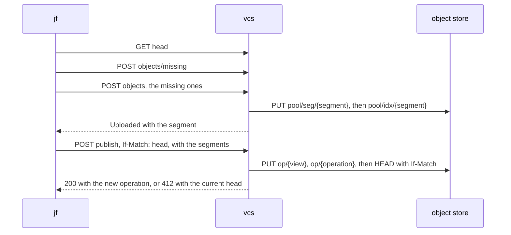

# Push and clone

The native sync of [#29](https://github.com/nca-apprentices/jjforge/issues/29).
vcs owns it, and `jf` speaks it over `sync/v1`, as
[ADR 0001](../adr/0001-native-jj-without-git.md) decides. The repository
lives in the object store, as
[ADR 0002](../adr/0002-state-boundaries-and-tokens.md) decides.

The spike [#62](https://github.com/nca-apprentices/jjforge/issues/62)
answered how `jf` and vcs build operations and how the store packs objects.
Each open question at the end of this page names the issue of the spike
that answers it. No requirement on this page is built until that section is
gone.

The scenarios create their repositories through the REST API of
[#23](https://github.com/nca-apprentices/jjforge/issues/23), and sign in as
the people of its seed.

## Clone a repository (#30)

[#30](https://github.com/nca-apprentices/jjforge/issues/30) states the
requirement.

| ID   | Functional requirement                                                                                                                                  |
| ---- | ------------------------------------------------------------------------------------------------------------------------------------------------------- |
| 30.1 | `jf clone <address> <dir>` creates a workspace with the store type `jjforge` and records the forge as the remote `forge`.                               |
| 30.2 | The clone's operation log holds every operation from the root to the forge's `HEAD`, under the same operation IDs.                                      |
| 30.3 | Each commit in the clone has the same commit ID, change ID, and tree terms as on the forge, because both hold the same `store.v1` bytes.                |
| 30.4 | The working copy starts a new change on `main@forge`, or on the root commit when `main` is absent.                                                      |
| 30.5 | A principal who can't read the repository gets 404 `not_found`, `jf` exits with 4, and no directory is left behind.                                     |

- Operations: `GET {base}/head`, `GET {base}/operations?since=`, and
  `POST {base}/objects/fetch`.
- Types: `sync.v1.Head`, `sync.v1.ObjectBundle`, `store.v1.Operation`,
  `store.v1.View`, `store.v1.Commit`, jj-lib's `Workspace` and
  `RepoLoader`, and the store crate's `Fetch`.
- Flow: [clone and fetch](#clone-and-fetch).

Scenario: [30-repo-clone.bats](../../e2e/cli/30-repo-clone.bats).

## Push a jj repository (#31)

[#31](https://github.com/nca-apprentices/jjforge/issues/31) states the
requirement.

| ID   | Functional requirement                                                                                                 |
| ---- | ---------------------------------------------------------------------------------------------------------------------- |
| 31.1 | `jf push --bookmark <name>` publishes each named bookmark and uploads every object it reaches that vcs lacks.          |
| 31.2 | A pushed commit keeps its commit ID, because `jf` stores it in the `store.v1` encoding that vcs stores.                |
| 31.3 | A conflicted commit keeps every term of its `TreeMerge` and its `conflict_labels`.                                     |
| 31.4 | The publish carries the predecessors of each pushed commit, and vcs writes them into `Operation.commit_predecessors`.  |
| 31.5 | After a publish, `jf` sets `<name>@forge` to the pushed target.                                                        |
| 31.6 | vcs refuses a malformed object with 400 `invalid`, and an object whose BLAKE3 hash differs from its name the same way. |

- Operations: `GET {base}/head`, `POST {base}/objects/missing`,
  `POST {base}/objects`, and `POST {base}/publish`.
- Types: `sync.v1.HashList`, `sync.v1.ObjectBundle`, `sync.v1.Uploaded`,
  `sync.v1.PublishRequest`, `sync.v1.BookmarkUpdate`,
  `sync.v1.PublishResponse`, `store.v1.StoredObject`, and the store crate's
  `Repo` and `push`.
- Flow: [push](#push).

Scenario: [31-repo-push.bats](../../e2e/cli/31-repo-push.bats).

## A pushed bookmark is visible at once (#32)

[#32](https://github.com/nca-apprentices/jjforge/issues/32) states the
requirement.

| ID   | Functional requirement                                                                                                  |
| ---- | ----------------------------------------------------------------------------------------------------------------------- |
| 32.1 | vcs answers a publish with 200 only after the object store has accepted the new `HEAD`.                                 |
| 32.2 | `GET {base}/head` reads `HEAD` from the object store on every request. No replica caches it.                            |
| 32.3 | A replica caches only immutable answers: objects, operations, and views by their ID.                                    |
| 32.4 | A publish completes within the p99 latency that [#110](https://github.com/nca-apprentices/jjforge/issues/110) measures. |

- Operations: `POST {base}/publish` and `GET {base}/head`.
- Types: `sync.v1.Head` and the store crate's `Repo`.
- Flow: [push](#push).

Scenario: [32-push-visible.bats](../../e2e/cli/32-push-visible.bats).

## A rejected push changes nothing (#33)

[#33](https://github.com/nca-apprentices/jjforge/issues/33) states the
requirement.

| ID   | Functional requirement                                                                                           |
| ---- | ---------------------------------------------------------------------------------------------------------------- |
| 33.1 | vcs checks every `BookmarkUpdate` of a publish before it writes anything. One refusal refuses the whole publish. |
| 33.2 | A bookmark whose `old_target` differs from the current view refuses the publish with 412 `precondition_failed`.  |
| 33.3 | A refused publish writes no operation and no view, and leaves `HEAD` where it was.                               |
| 33.4 | A principal outside the organization gets 404 `not_found`, and one without write scope 403 `forbidden`.          |

- Operations: `POST {base}/publish`.
- Types: `sync.v1.PublishRequest`, `sync.v1.BookmarkUpdate`,
  `store.v1.RefTarget`, and the store crate's `Repo`.
- Flow: [push](#push), from step 1 to step 3.

Scenario: [33-push-atomic.bats](../../e2e/cli/33-push-atomic.bats).

## Import an existing jj repository (#88)

[#88](https://github.com/nca-apprentices/jjforge/issues/88) states the
requirement.

| ID   | Functional requirement                                                                                            |
| ---- | ----------------------------------------------------------------------------------------------------------------- |
| 88.1 | `jf import <path> <address>` opens the repository at the path with jj-lib's default store factories, without git. |
| 88.2 | It writes each commit as a `store.v1.Commit`, parents first. Each keeps its change ID and gets a new commit ID.   |
| 88.3 | It records each old commit ID and its new one in `.jj/repo/jjforge-import` of the source repository.              |
| 88.4 | It publishes the source's bookmarks in one operation.                                                             |
| 88.5 | A second import converts and uploads only the commits that the record lacks.                                      |

- Operations: the operations of a push.
- Types: jj-lib's `Backend::read_commit` and `CommitBuilder`, and
  `store.v1.Commit`.
- Flow: [import](#import).

Scenario: [88-repo-import.bats](../../e2e/cli/88-repo-import.bats).

## Two pushes at once lose nothing (#89)

[#89](https://github.com/nca-apprentices/jjforge/issues/89) states the
requirement.

| ID   | Functional requirement                                                                                                                          |
| ---- | ----------------------------------------------------------------------------------------------------------------------------------------------- |
| 89.1 | A publish whose `If-Match` names a stale head gets 412 `precondition_failed` with the current `Head`, and vcs writes nothing.                   |
| 89.2 | On 412, `jf` fetches, merges with `RepoLoader::merge_operations`, and publishes again against the new head.                                     |
| 89.3 | Two publishes that change different bookmarks both land.                                                                                        |
| 89.4 | When the merge leaves a pushed bookmark conflicted, `jf` stops, reports the conflict, and exits with 6.                                         |
| 89.5 | `jf` retries at most as often, and vcs answers within the latency, that [#110](https://github.com/nca-apprentices/jjforge/issues/110) measures. |

- Operations: `POST {base}/publish` and the operations of a fetch.
- Types: `sync.v1.Head`, `sync.v1.PublishRequest`, and the store crate's
  `Repo` and `Published`.
- Flow: [push](#push), step 5.

Scenario: [89-concurrent-push.bats](../../e2e/cli/89-concurrent-push.bats).

## A large clone is usable at once (#90)

[#90](https://github.com/nca-apprentices/jjforge/issues/90) states the
requirement.

| ID   | Functional requirement                                                                                                                                                 |
| ---- | ---------------------------------------------------------------------------------------------------------------------------------------------------------------------- |
| 90.1 | A clone fetches the operations, the views, and the commits they reach, and no tree or file.                                                                            |
| 90.2 | `Backend::read_tree` and `Backend::read_file` fetch a missing object with `POST {base}/objects/fetch`, bundled with its siblings.                                      |
| 90.3 | A fetched object stays in the local store and is never fetched again.                                                                                                  |
| 90.4 | `jf log`, `jf op log`, `jf evolog`, and every other history command read no tree or file.                                                                              |
| 90.5 | A checkout fetches only the trees and files of the commit it checks out, within the limit that [#109](https://github.com/nca-apprentices/jjforge/issues/109) measures. |

- Operations: `POST {base}/objects/fetch`.
- Types: `sync.v1.HashList`, `sync.v1.ObjectBundle`, and the store
  crate's `Fetch` and `Backend`.
- Flow: [clone and fetch](#clone-and-fetch), step 4.

Scenario: [90-lazy-clone.bats](../../e2e/cli/90-lazy-clone.bats).

## A pushed repository survives a restart (#97)

[#97](https://github.com/nca-apprentices/jjforge/issues/97) states the
requirement.

| ID   | Functional requirement                                                                    |
| ---- | ----------------------------------------------------------------------------------------- |
| 97.1 | vcs keeps no state between requests except caches of immutable objects.                   |
| 97.2 | Every write reaches the object store before vcs answers it.                               |
| 97.3 | After every service restarts, `HEAD` and every object read back from the object store.    |

- Operations: every operation of a push and a clone.
- Types: the store crate's `Repo`.
- Flow: [push](#push), step 4.

Scenario: [97-survives-restart.bats](../../e2e/cli/97-survives-restart.bats).

## Fetch into an existing clone (#101)

[#101](https://github.com/nca-apprentices/jjforge/issues/101) states the
requirement.

| ID    | Functional requirement                                                                                                            |
| ----- | --------------------------------------------------------------------------------------------------------------------------------- |
| 101.1 | `jf fetch` reads `GET {base}/head` and changes nothing when the head equals the last operation it fetched, and the view's `<name>@forge` bookmarks match it. |
| 101.2 | Otherwise it fetches the operations since that one, merges them into its own, and sets each `<name>@forge` to the forge's target. |
| 101.3 | A rewritten change shows its new commit under the same change ID, and the old commit is hidden, as `commit_predecessors` records. |

- Operations: `GET {base}/head` and `GET {base}/operations?since=`.
- Types: `sync.v1.Head`, `sync.v1.ObjectBundle`, `store.v1.View` with its
  `remote_views["forge"]`, and jj-lib's `RepoLoader`.
- Flow: [clone and fetch](#clone-and-fetch), from step 2 to step 3.

Scenario: [101-repo-fetch.bats](../../e2e/cli/101-repo-fetch.bats).

## Each operation names who made it (#102)

[#102](https://github.com/nca-apprentices/jjforge/issues/102) states the
requirement.

| ID    | Functional requirement                                                                                                            |
| ----- | --------------------------------------------------------------------------------------------------------------------------------- |
| 102.1 | vcs sets `Operation.username` to the certificate's key ID and `Operation.hostname` to `jjforge`.                                 |
| 102.2 | vcs records the delegation chain in `Operation.attributes` under `jjforge.delegation`, as subjects from the outermost actor in.   |
| 102.3 | vcs sets the start and end time from its own clock. `PublishRequest` carries no name and no time, so a client can't claim either. |

- Operations: `POST {base}/publish`.
- Types: `store.v1.Operation`, and the store crate's `Author`, which vcs
  builds from the verified session.
- Flow: [push](#push), step 4.

Scenario: [102-operation-author.bats](../../e2e/cli/102-operation-author.bats).

## A clone shows how each change evolved (#103)

[#103](https://github.com/nca-apprentices/jjforge/issues/103) states the
requirement.

| ID    | Functional requirement                                                                                                                   |
| ----- | ---------------------------------------------------------------------------------------------------------------------------------------- |
| 103.1 | `PublishRequest.commit_predecessors` maps each pushed commit to the versions of its change that the forge holds and that it replaced.    |
| 103.2 | A version that never left the clone, such as a snapshot of the working copy, stays private: `jf` uploads only what pushed commits reach. |
| 103.3 | `jf evolog` in a clone lists every version of a change that the forge saw, newest first.                                                 |

- Operations: `POST {base}/objects` and `POST {base}/publish`.
- Types: `sync.v1.PublishRequest`, `store.v1.CommitIds`, and
  `store.v1.Operation`.
- Flow: [push](#push), step 2.

Scenario: [103-change-history.bats](../../e2e/cli/103-change-history.bats).

## Out of scope

- Reading a repository that git backs. `jf` has no git in it, as
  [ADR 0001](../adr/0001-native-jj-without-git.md) decides, so an import
  reads only a repository on jj's own backend until
  [#120](https://github.com/nca-apprentices/jjforge/issues/120) answers how
  to import one that git backs.
- Protected bookmarks and the landing queue, which the
  [review model](143-review-model.md) specifies.
- Collecting unreachable objects. Nothing is collected, as
  [ADR 0002](../adr/0002-state-boundaries-and-tokens.md) decides.

## Flow

### Push

Operation `publish` by principal P, from `jf push`.



1. Session: `jf` signs a challenge with the key of its certificate and opens
   a session, and vcs checks the session on every route. Refused: 401
   `unauthenticated`. A principal without a scope for the
   organization gets 404 `not_found`, and one with read scope only 403
   `forbidden`.
2. Objects: `jf` walks the commits that the pushed bookmarks reach and the
   forge's heads don't, and asks which objects vcs lacks, one generation of
   the tree at a time. An object vcs holds reaches only objects it holds,
   so the walk stops there. vcs decodes every uploaded object and refuses a
   malformed one, an operation, or a view: 400 `invalid`. It names each
   object by the BLAKE3 hash of its bytes and writes the upload as one
   segment with its index. `jf` bundles objects up to 16 MiB per upload and
   refuses an object of more than 63 MiB before it uploads anything. The earlier
   versions of a pushed change that the forge holds become its
   predecessors. A version between them that never left the clone stays
   private, so a push publishes only what the pushed commits reach.
3. Publish: vcs refuses a stale head, named in the body and in `If-Match`,
   or a bookmark whose `old_target` differs from the view at `HEAD`: 412
   `precondition_failed` with the current head in `ETag`. It refuses a
   segment the repository lacks, and a new visible commit that reaches an
   object that neither the log nor the segments of the publish hold: 400 `invalid`.
4. Operation: vcs loads the repository at `HEAD` with jj-lib, over its own
   index. A `MutableRepo` adds each new bookmark target and each of
   `head_ids` as a head, sets the bookmarks, and removes each commit that
   `commit_predecessors` names as replaced and each of `hidden_ids` from the
   heads. jj-lib keeps the heads consistent. vcs writes the view, then the
   operation with P, the delegation chain, its own time, the predecessors,
   and the segments, then moves `HEAD` with `If-Match`.
5. Race: on 412 `jf` fetches, merges, and publishes again after a random
   wait that doubles each time, at most ten times until
   [#110](https://github.com/nca-apprentices/jjforge/issues/110) measures
   the limit. A pushed bookmark that ends up conflicted stops the push.
6. Local view: `jf` fetches the new operation, so `<name>@forge` shows what
   the forge holds.

### Clone and fetch

1. `jf clone` creates the workspace with the store type `jjforge` and
   records the clone address in `.jj/repo/forge/url`.
2. `jf` reads `head`, then `operations?since=` the forge operation it
   fetched last, from `.jj/repo/forge/head`. It writes the operations and
   views to its op store as the same bytes, so each keeps its ID.
3. `jf` fetches the commits that the new views' heads reach, and the
   earlier versions that the new operations name, one generation per
   request, and no tree or file. The forge holds everything these reach,
   as step 3 of the push decides.
4. One transaction merges the forge's operation into the local head with
   `Transaction::merge_operation`, and rebases local descendants of
   rewritten commits. The merge starts from the forge operation that the
   view's `<name>@forge` bookmarks reflect, which is the one fetched last
   unless `jj op restore` or `jj undo` took the view back. It sets each
   `<name>@forge` to the forge's target, and its operation has both heads as
   parents. `jf` records the forge's head as fetched. A push whose view
   lags the last fetch fetches first, so it moves no bookmark back. jj
   undoes no merge, so `jf undo` of a fetch restores its first parent, and
   the next fetch brings the forge's operations back.
5. A clone then starts a new change on `main@forge`, or on the root commit,
   and checks it out.
6. The working copy reads trees and files through the backend. A read that
   misses the local store fetches the object from vcs, and a tree brings the
   entries it names in one more request. Each fetched object stays in
   `.jj/repo/store`, as
   [ADR 0001](../adr/0001-native-jj-without-git.md) decides.

### Import

`jf import` opens the local repository through jj-lib's factories, reads
each commit with `Backend::read_commit`, writes it in the store format with
the same change ID, and pushes the result as one operation.

## Persistence

The object store holds each repository at `t/{org}/r/{repo}/`, as
[ADR 0002](../adr/0002-state-boundaries-and-tokens.md) decides:

```text
pool/seg/{segment}   the encoded objects of one upload, one after another
pool/idx/{segment}   where each object of the segment starts and ends
op/{hash}            operations and views
HEAD                 the current operation and review operation, as an
                     encoded store.v1.Head
SERVED               written once, when vcs creates the repository
```

- A segment's ID is the hash of its bytes. Its index is `JJFIDX01`
  followed by one entry per object, sorted by hash, with no hash twice: the
  32-byte hash, the offset as 8 bytes, and the length as 4 bytes, both
  big-endian, and a byte that is 1 for a commit or a tree. A reader finds an
  object with one range read, and the check of a publish reads only the
  commits and trees, at most 16 MiB at once.
- An operation's `segment_ids` name the segments of the objects it made
  visible, so the log alone finds every object. vcs keeps a catalog per
  repository in memory, built from the log, and adds the operations that
  `HEAD` reaches since it last looked.
- vcs keeps jj's index of each repository under its cache directory, and
  rebuilds it from the log when the directory is gone.
- A clone keeps one file per object under `.jj/repo/store/` and
  `.jj/repo/op_store/`, named by its ID in hexadecimal. `.jj/repo/forge/`
  holds the clone address and the last fetched head.

A push touches no Postgres table.

## Architecture

The paths cross three crates. Each crate exposes only the items below, and
keeps the rest in private modules, as
[ADR 0003](../adr/0003-checked-code-rules.md) decides. Only the store crate
depends on jj-lib and on `object_store`, which cargo-deny checks.

| Crate | Item                                   | Kind        | Role                                                                                                                                                                                       |
| ----- | -------------------------------------- | ----------- | ------------------------------------------------------------------------------------------------------------------------------------------------------------------------------------------ |
| store | `OperationId`, `ObjectId`, `SegmentId` | struct      | The 32-byte BLAKE3 IDs that both sides name operations, objects, and segments by, with their hexadecimal form.                                                                             |
| store | `Published`                            | enumeration | `Moved` with the new operation, or `Stale` with the current head.                                                                                                                          |
| store | `client`                               | module      | `jf`'s side. jj-cli loads the store type through it, and a clone syncs with its forge through it.                                                                                          |
| store | `client::factories`, `init`, `config`  | function    | Register the store type `jjforge` with a backend that fetches from the clone's forge, create a workspace on it, and turn off predecessors in commits.                                      |
| store | `client::Fetch`, `Transport`           | trait       | The `sync/v1` calls the backend and the client make. `jf` implements both.                                                                                                                 |
| store | `client::Forge`                        | struct      | `fetch` and `push`, `jf`'s side of the Flow section, each answering `Synced`.                                                                                                              |
| store | `client::forge_url`, `set_forge_url`   | function    | Read and record the clone address under `.jj/repo/forge/`, next to the last fetched head.                                                                                                  |
| store | `client::start_on_main`                | function    | Starts the working copy of a clone on `main@forge`.                                                                                                                                        |
| store | `client::follow_working_copy`          | function    | Checks out the working-copy commit when a fetch rebased it.                                                                                                                                |
| store | `client::undo_fetch`                   | function    | Restores the clone from before a fetch, which `jf undo` calls, because jj undoes no merge operation.                                                                                       |
| store | `server`                               | module      | vcs's side: the repositories in the object store.                                                                                                                                          |
| store | `server::Repos`, `Repo`                | struct      | The repositories under one object store URL, and one repository, which vcs opens by its two IDs for every route.                                                                           |
| store | `Repo::create`, `delete`               | method      | Write `HEAD` at the root operation, or remove the prefix, for [#25](https://github.com/nca-apprentices/jjforge/issues/25) and [#28](https://github.com/nca-apprentices/jjforge/issues/28). |
| store | `Repo::head`                           | method      | Reads `HEAD`. A repository without one doesn't exist.                                                                                                                                      |
| store | `Repo::missing`                        | method      | Answers which of a list of IDs the log doesn't reach.                                                                                                                                      |
| store | `Repo::upload`                         | method      | Verifies and writes objects as one segment with its index.                                                                                                                                 |
| store | `Repo::fetch`                          | method      | Reads objects by ID, one range read per segment.                                                                                                                                           |
| store | `Repo::operations_since`               | method      | Reads the operations and views after an operation.                                                                                                                                         |
| store | `Repo::publish`                        | method      | Builds the view with jj-lib, writes it and the operation, and moves `HEAD` by compare-and-swap.                                                                                            |
| store | `server::Author`                       | struct      | The subject and the delegation chain that go into the operation's metadata.                                                                                                                |
| vcs   | `gate`                                 | module      | `Gate`, the one way a request reaches a `Repo`: it verifies the session, checks the access, and records whom the span is for.                                                              |
| vcs   | `sync`                                 | module      | The `sync/v1` routes over HTTP, with a server span per request. Each handler takes a `Reader` or a `Writer` that the gate opened.                                                          |
| vcs   | `grpc`                                 | module      | `echo/v1`, and the `SessionService`, `RepoService`, `HistoryService`, `FileService`, and `DiffService` of `source/v1` for the server, through the gate.                                   |
| vcs   | `auth`                                 | module      | Opens a session from a signed challenge and a certificate of a trusted authority, and reads its scopes and delegation chain.                                                               |
| `jf`  | `commands`                             | module      | `clone`, `fetch`, `push`, and `import`, added to jj-cli, and a hook that lets `undo` undo a fetch.                                                                                         |
| `jf`  | `forge`                                | module      | `SyncClient`, the `sync/v1` client, which implements `Fetch` and `Transport` and opens the session.                                                                                       |
| `jf`  | `credential`                           | module      | The key that `JJFORGE_KEY` names and its certificate, and signing with `ssh-keygen -Y sign`.                                                                                               |

External systems and their twins in `shared/deploy/compose.yaml`: the object
store as `seaweedfs`. vcs trusts the development certificate authority of
`shared/deploy/twins/cert`, which signs a certificate for each person of
the seed, and the scenarios create repositories through `RepoService` on vcs.

## Libraries

### jj-lib and jj-cli 0.46.0

Both are pinned to `=0.46.0` and built without git or watchman, as
[ADR 0001](../adr/0001-native-jj-without-git.md) decides. Only `jf` and the
store crate depend on them, as
[ADR 0003](../adr/0003-checked-code-rules.md) decides.

The store crate implements three traits and registers them under the store
type `jjforge` with `StoreFactories::add_backend`, `add_op_store`, and
`add_op_heads_store`. `jf` passes them to `CliRunner::add_store_factories`.

| Trait          | Methods jjforge implements                                                                                                                      | Over                                                                                                      |
| -------------- | ----------------------------------------------------------------------------------------------------------------------------------------------- | --------------------------------------------------------------------------------------------------------- |
| `Backend`      | `read_file`, `write_file`, `read_symlink`, `write_symlink`, `read_copy`, `write_copy`, `read_tree`, `write_tree`, `read_commit`, `write_commit` | `store.v1` objects named by BLAKE3                                                                        |
| `OpStore`      | `read_view`, `write_view`, `read_operation`, `write_operation`, `resolve_operation_id_prefix`                                                   | `op/{hash}`                                                                                               |
| `OpHeadsStore` | `get_op_heads`, `update_op_heads`, `lock`                                                                                                       | jj-lib's `SimpleOpHeadsStore` in `jf`. vcs reads and moves `HEAD` itself, so its store refuses both calls |

jjforge maps these jj-lib types onto `store.v1`:

| jj-lib type                   | Fields                                                                                                     | `store.v1`                     |
| ----------------------------- | ---------------------------------------------------------------------------------------------------------- | ------------------------------ |
| `backend::Commit`             | `parents`, `root_tree`, `conflict_labels`, `change_id`, `description`, `author`, `committer`, `secure_sig` | `Commit`                       |
| `backend::Tree`, `TreeValue`  | entries by name, each a file, a symbolic link, or a tree                                                   | `Tree`, `TreeEntry`, `FileRef` |
| `MergedTree`                  | a merge of tree IDs, which is how a commit holds a conflict                                                | `TreeMerge`                    |
| `backend::CopyHistory`        | `current_path`, `parents`, `salt`                                                                          | `CopyHistory`                  |
| `op_store::Operation`         | `view_id`, `parents`, `metadata`, `commit_predecessors`                                                    | `Operation`                    |
| `op_store::OperationMetadata` | `time`, `description`, `hostname`, `username`, `is_snapshot`, `workspace_name`, `attributes`               | `Operation`                    |
| `op_store::View`              | `head_ids`, `local_bookmarks`, `local_tags`, `remote_views`, `wc_commit_ids`                               | `View`                         |
| `op_store::RemoteView`        | `bookmarks` and `tags`, each a `RemoteRef` with its target and whether it is tracked                       | `RemoteView`, `RefTarget`      |

The calls jjforge makes beyond the traits:

- vcs: `RepoLoader::new` over its own stores, `load_at`, `MutableRepo::new`,
  `add_heads`, `set_local_bookmark_target`, `remove_head`, `consume`, and
  `IndexStore::write_index`. `Transaction` can't take predecessors from a
  request, so vcs writes the operation itself.
- `jf`: `OpStore::read_view`, `Transaction::merge_operation`,
  `MutableRepo::rebase_descendants`, `set_remote_bookmark`, and `set_view`,
  `CliRunner::add_dispatch_hook`,
  `ResolvedRevsetExpression` for the commits to push,
  `evolution::walk_predecessors`, and `Workspace::check_out`.

jjforge leaves these parts of jj-lib unused:

- `View::git_refs` and `View::git_heads`, the git backend, and the secret
  backend.
- `Commit::predecessors`, which jj deprecates. `jf` sets
  `experimental.record-predecessors-in-commit` to false, and
  `Operation.commit_predecessors` records the same.
- `Backend::get_related_copies`, which needs an index of copies the store
  doesn't keep, and copy records, which the store doesn't record yet.
- `OpStore::gc`, which does nothing, because nothing is collected.
- The index store and the working copy, which stay jj-lib's defaults:
  `DefaultIndexStore` builds its index locally from the commits, and
  `LocalWorkingCopy` checks out files on disk.

### `object_store` 0.14.2

The store crate reaches the object store through `object_store` with the
features `aws-base`, `fs`, `reqwest`, and `ring`, so its TLS runs on ring as
the rest of the stack does. It uses `get`, `get_ranges`, `put_opts` with
`PutMode::Create` for every immutable object and `PutMode::Update` with the
entity tag for `HEAD`, `list`, and `delete_stream`. A local disk has no
conditional replace, so vcs on `file://` moves `HEAD` under a lock of its
own process, and one process serves it.

### `ssh-key` 0.6.7

vcs parses certificates with `Certificate::from_openssh`, checks them with
`validate_at` against the fingerprints of its authorities, and verifies a
challenge's signature with `PublicKey::verify` over an `SshSig`. It enables
Ed25519 and ECDSA P-256 only, because the `rsa` crate carries an open
advisory. `validate_at` checks neither the principals nor the critical
options, so vcs refuses every certificate with a critical option and takes
the principal from the key ID. vcs seals sessions and challenges with
ring's HMAC-SHA256.

## Security

- vcs opens a session only for a user certificate that an authority in
  `VCS_AUTHORITIES` signed and that holds now, and only from a signature
  by the certificate's key over the origin that `jf` connected to and a
  challenge that vcs issued less than a minute before, in the namespace
  `jjforge-session`. vcs refuses an origin outside `VCS_ORIGINS`, or any
  but a loopback one when that is empty, so a forge that relays another
  forge's challenge gains nothing. A challenge can be used again within its
  minute, because vcs keeps no state. Each entry,
  `{org}={path}`, trusts an authority for one organization, and a
  certificate's scopes reach only the organizations whose authorities
  signed it. The extension `jjforge-scope@nca-apprentices.dev` grants
  `sync:read:{org}` or `sync:write:{org}`. Creating or deleting a
  repository through `RepoService` needs `sync:admin:{org}`, which a
  certificate for pushing lacks. The extension
  `jjforge-delegation@nca-apprentices.dev` names the principals that
  delegated to it. A session lasts 15 minutes at most and never outlives
  its certificate. vcs ignores every name the client sends, so an operation
  names the principal from the certificate's key ID.
- vcs verifies the hash of every object it reads back, decodes every
  uploaded object, and computes each object's name itself, so a client
  can't store bytes under another object's name.
- A publish makes visible only commits whose objects the repository holds,
  so a repository can't point at another repository's objects.
- A publish hides the commits it names as replaced. Until
  [#65](https://github.com/nca-apprentices/jjforge/issues/65) decides who
  may rewrite a change, any principal with write scope can hide a head, as
  it can move any bookmark.
- A request body has a limit of 64 MiB, answered with 413 before vcs reads
  it, and a request names at most 1,000 IDs, or 400 `invalid`. Every error,
  the ones the HTTP framework answers included, is
  `application/problem+json`. The limits per object and per bundle come
  from the measurement of [#110](https://github.com/nca-apprentices/jjforge/issues/110).

## Failures

A crash after a segment is written and before `HEAD` moves leaves a segment
that no operation names. Nobody reads it, and it costs storage only. A
publish that retries names it again, and the same objects write the same
segment.

A crash after the view or the operation is written and before `HEAD` moves
leaves objects that `HEAD` doesn't reach. The client gets no answer and
publishes again, which writes a new operation. The old one stays
unreachable.

A replica that loses its cache rebuilds jj's index from the log on the next
publish, and its catalog from the operations on the next read. A catalog
whose operations the log no longer reaches belongs to a repository created
again under the same IDs, so the replica builds it anew.

An attempt after a lost race names the segments that earlier attempts
uploaded, and uploads nothing again. A push that loses every retry reports
the race, and its segments stay in the store, which no operation names.

## Tests

- The store crate passes jj-lib's tests for a backend and an op store,
  ported to the `jjforge` store type, because jj-lib publishes no
  conformance tests, as
  [ADR 0001](../adr/0001-native-jj-without-git.md) decides.
- A round trip of each jj-lib type in the Libraries table through
  `store.v1` returns an equal value.
- An integration test of the store crate runs clones against one forge
  repository in process: a push that another clone fetches with the same
  IDs, lazy reads, two pushes at once, a conflict, and a rewritten change.
- `shared/e2e/cli/sync.bats` runs two `jf` copies that push to one
  repository on SeaweedFS at once, as
  [#108](https://github.com/nca-apprentices/jjforge/issues/108) asks.

## Open questions

- The limits on push latency, retries, and upload size, from compare-and-swap
  on the cluster's SeaweedFS.
  [#110](https://github.com/nca-apprentices/jjforge/issues/110) answers it.
- The time until a clone of 100,000 files is usable with the lazy reads of
  the Flow section, for the limit of #90.
  [#109](https://github.com/nca-apprentices/jjforge/issues/109) answers it.
- How a person imports a repository that git backs, since `jf` has no git.
  [#120](https://github.com/nca-apprentices/jjforge/issues/120) answers it.
